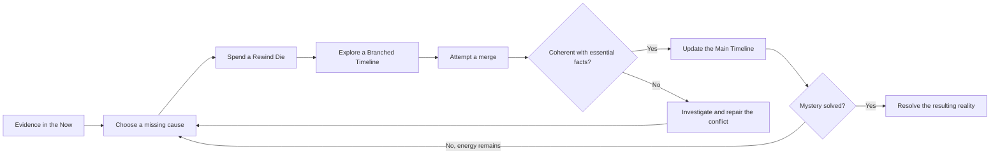

# Causality — Publisher and Investor Presentation Source

> **Discover the truth. Keep reality intact.**
>
> A cooperative tabletop RPG where every answer must survive its consequences.

## 1. Purpose and editorial status

This is the master source for a teaser, pitch deck, publisher submission, or investor conversation about **Causality**. It combines reusable presentation copy with a factual project brief and proposed commercial directions. Here, “publisher” means a tabletop game publishing partner.

- **Prepared:** 27 October 2026, from the repository documentation available on that date.
- **Canonical language:** English. [French companion](../i18n/fr/source-presentation.md).
- **Documented:** supported by the linked project sources; this does not mean independently audited.
- **Proposed:** a positioning, product, or presentation idea for discussion, without a production commitment.
- **To complete:** information the creator must supply before the relevant claim appears in an external presentation.

The public teaser can use sections 2–7 and the story outline in section 13. Sections 8–12 supply partner discussion material. Section 14 is the internal completion checklist. Scenario hooks below avoid revealing the culprits and solutions contained in the GM sources.

## 2. The hook

### Primary tagline — proposed

**Discover the truth. Keep reality intact.**

### Alternative taglines — proposed

- Every answer has consequences.
- You remember a world that never happened.
- Twenty steps into causality. One reality to preserve.

### One-sentence pitch

**Causality is a cooperative tabletop role-playing game in which investigators replay the causes of a mystery, test alternate chains of events, and merge their discoveries into a coherent present before their energy runs out.**

### Thirty-second spoken pitch

> What if solving a mystery could erase the world that asked you to solve it? In Causality, investigators use a mysterious System to replay chains of cause and effect. Each alternate branch can reveal evidence, create contradictions, and leave memories of a reality nobody else remembers. With limited dice to spend, the group must discover the truth and bring its findings back into one coherent present. The rules draft, five scenarios, and English and French documentation already exist; the next step is broader testing and development toward publication.

### Short presentation paragraph

**Causality is a cooperative causal-investigation tabletop role-playing game for 2 to 5 players and one Game Master.** In its setting, time does not exist: each event follows from those before it, and this coherent chain can be unwound like reversible flow in a viscous fluid.

The **System** is a complex scientific device combining a quantum computer with the mass and energy properties of a micro black hole. In the fiction, research unified quantum mechanics and spacetime by replacing the temporal component with the **general causality theorem**. The System is its application.

It opens the **Causality Gate**, centered on the **Main Timeline**, providing access to the **Time Flow**. Investigators act within **Branches**, short for **Branched Timelines**, then attempt a **Merge** to return to the shared **Now**. Rewind Dice represent their **dark-energy capsules**. Changing a cause can erase evidence or the conditions for an Investigator's existence; unintegrated Branches increase cognitive load, measured by Mental Load, risking madness.

For the scientific fiction and Couette cell analogy, see [Universe and System](./universe-and-system.md). For a presentation centered on Toulouse and Glass Fever Protocol, use the [dedicated NotebookLM source](./notebooklm-presentation-source.md).

The present is evidence. Somewhere behind it lies a chain of causes nobody fully understands. Causality puts that chain on the table: players follow clues, spend precious Rewind Dice to open alternate branches, and test what really happened. A discovery becomes part of shared reality only when its consequences can be reconciled with the present. Contradictions demand new investigation. Unmerged realities leave memories behind. The mystery ends with one observable world—and investigators who may remember several.

## 3. Project at a glance — documented

| Item | Current project information |
|---|---|
| Format | Cooperative tabletop role-playing game with a Game Master. |
| Group | 1 Game Master and 2–5 players, as specified in the quickstart. |
| Core experience | Investigation, causal reasoning, shared storytelling, resource decisions, and psychological pressure. |
| Premise | The System replays causality and maintains possible states; investigators do not physically travel through time. |
| Play structure | Exactly 20 Atomic Time Units before the Now; scenario scale can cover hours, years, or centuries. |
| Equipment | Shared board or large paper, cards or sticky notes, and one standard seven-die polyhedral set per investigator. |
| Digital requirement | The documented table setup can be played without an app. A shared digital board is an alternative. |
| Development stage | Design draft with rules and materials ready for further playtesting; balance questions remain open. |
| Available scenarios | Five written GM scenario preparations. |
| Recorded table test | Glass Fever Protocol starter mode: 2 players, approximately 4 hours, without an active Time Offender. |
| Languages | English canonical documentation and French companion material. |
| Repository license | CC0 1.0 Universal, as stated in the repository license and contribution guide. |
| Commercial readiness | Release date, production specification, pricing, budget, team credits, and commercial traction are to complete. |

The four-hour observation applies to that starter test only. It is not a validated duration for all scenarios or group sizes. The 2–5-player specification is a design target beyond the recorded two-player configuration.

Sources: [overview](../README.md), [quickstart](./quickstart.md), [starter table validation](./scenarios/glass-fever-protocol-gm-prep.md#table-validation), [language policy](../i18n/README.md), [license](../LICENSE).

## 4. What players actually do

The Game Master prepares a hidden network of **Facts**, **Conditions**, and **Evidence**. Players begin with an incomplete case file and build a shared **Main Timeline** from confirmed discoveries.

1. **Investigate:** examine evidence and identify a missing cause.
2. **Commit:** choose an earlier Time Unit and spend a Rewind Die.
3. **Explore:** act inside a temporary **Branched Timeline** and discover or change facts.
4. **Merge:** replay the resulting consequences toward the **Now**.
5. **Repair:** resolve contradictions through choices or further causal action.
6. **Preserve:** maintain a coherent reality while managing energy and **Mental Load**.

An opening can also fail and still spend its die. The diagram summarizes the successful-opening loop rather than every dice outcome.

### A concrete table moment

The Main Timeline establishes that a laboratory exploded. An investigator opens a branch, finds a code, and defuses the bomb. That action reveals something important, but its merge is blocked: an essential fact no longer has a cause. The group must investigate or create a compatible causal chain before the branch can join the shared present.

**The dramatic question:** what will you do with the truth when your actions threaten the reality you need to preserve?

This example is adapted from the [rules examples](./game-design.md#27-short-example). The rules also allow a coherent accepted Now; the pitch should not imply that every incidental detail is permanently immutable.

## 5. Why the experience stands out

These are distinctions supported by the design, not claims of market exclusivity.

| Design feature | What it creates for players | Presentation image — proposed |
|---|---|---|
| Investigation through causal replay | Players test explanations through action and see their consequences. | A clue becoming a branching chain of events. |
| Merges and structural conflicts | Discoveries require coherence; major contradictions need further action rather than a lucky roll. | Two branches approaching a blocked junction. |
| Dice as limited System energy | A visible supply of opportunities makes each rewind a commitment. | A die removed from a small remaining reserve. |
| Distance-dependent rewind risk | The group weighs a deeper investigation against scarce resources. | A long branch reaching toward an older event. |
| Mental Load from unresolved realities | Alternate experiences create personal stakes even when they never become shared reality. | One investigator holding incompatible witness photos. |
| Shared causal map | The group's reasoning becomes visible and changes during play. | Hands connecting evidence cards around a table. |
| Flexible scenario scale | The same twenty-unit structure supports different eras and kinds of mystery. | Family records, quarantine files, battlefield orders. |

Keep three ideas on the main teaser slides: **test the causes, merge the consequences, remember the impossible.**

## 6. Rules detail for presenter notes — documented

- Each investigator begins with **10 Health** and **0 Mental Load**.
- The six single-use Rewind Dice represent **dark-energy capsules**: **d4, d6, d8, d10, d12, and d20**. The percentile d10 is used for action rolls; action and damage rolls consume no capsule.
- Any available Rewind Die may target a distance of 1–20 Time Units. The opening score is `(die result / rewind distance) × 100`; high results are better.
- **Minor Conflicts** use a player choice and percentage action roll affected by Mental Load. **Major Conflicts** block a merge and require causal repair.
- End-of-turn Mental Load is `30 × non-Merged branches + 40 × unresolved Major Conflicts + 20 × unresolved Minor Conflicts + other active penalties`. At 100 or more, the character loses psychological coherence under the current rules.
- Fictionally valid attacks hit automatically; combat rolls determine damage. Investigation is the central challenge.
- Endings include complete convergence, incomplete convergence, psychological divergence, and causal rupture.

The full rules, rather than this presentation document, govern play. Rewind outcomes, damage, final divergence penalties, and other open design questions still need testing. Sources: [game design](./game-design.md), [quickstart](./quickstart.md), [investigator sheet](./investigator-sheet.md).

## 7. A portfolio of mysteries — documented content, proposed teaser copy

| Scenario | Spoiler-light teaser | What the design explores |
|---|---|---|
| **Glass Fever Protocol** | Sealed cities. A devastating disease. An official story that fits too neatly. Find the origin and preserve evidence of a cure without erasing the world that sent you. | Starter investigation, evidence chains, optional active adversary. |
| **Ashfall Battalion** | A doomed landing repeats. Every remembered death brings a clue—and a cost. Find the command source before the next attempt becomes the last. | Tactical loops, hostile Counter-System, memory pressure. |
| **The Clockmaker's Child** | A family begins to unravel when the meeting that made it possible is disrupted. Rebuild an origin without destroying the cause of its repair. | Identity, relationships, family-origin paradox. |
| **The Iron Witness** | A machine pursuer attacks the chain that will one day produce a decisive testimony. Protect an archive's origin while its future is hunting you. | Pursuit, survival, archive continuity, bootstrap dependencies. |
| **Public Record Trap** | The records say you were there. The witnesses agree. You remember choosing otherwise. Investigate a paper trail that is turning into a command. | Bureaucratic suspense, identity, manipulated evidence. |

These are written scenario materials, not five independently validated products. GM sources contain spoilers: [Glass Fever](./scenarios/glass-fever-protocol-gm-prep.md), [Ashfall](./scenarios/ashfall-battalion-gm-prep.md), [Clockmaker](./scenarios/clockmakers-child-gm-prep.md), [Iron Witness](./scenarios/iron-witness-gm-prep.md), [Public Record](./scenarios/public-record-trap-gm-prep.md).

## 8. What already exists, and what that proves

| Asset or evidence | Supported statement | Limit |
|---|---|---|
| Core design reference | The main concepts, resolution procedures, and open questions are written. | A rules draft does not establish finished balance. |
| Quickstart and GM guide | The repository includes first-session setup and a scenario-building workflow. | Independent onboarding and preparation time need measurement. |
| Five scenario preparations | The premise has been developed across several kinds of mystery. | Written examples and playthroughs do not establish five real table tests. |
| Starter scenario table-validation note | A two-player starter test is recorded as playable, taking about four hours. | One recorded configuration cannot establish general usability or demand. |
| Investigator sheet and six dice reference pages | Practical play aids exist for resource and outcome tracking. | Publication layout and accessibility are not established. |
| English and French materials | There is an existing bilingual documentation structure. | Editorial review and localization quality still need assessment. |
| Local Python dice utility | A tool supports dice rolls and reference-table generation. | Simulation is not evidence of player enjoyment or commercial traction. |
| Temporal-effect catalog | Additional narrative design material exists. | Catalog entries are not shipped modules or licensed third-party adaptations. |

No verified sales, audience size, mailing-list totals, preorders, awards, publisher agreements, or investment commitments have been identified in the reviewed documentation. Add them only with evidence and a date.

Sources: [documentation index](../README.md#documentation), [GM guide](./game-master-guide.md), [dice references](./abacus/README.md), [dice utility](../scripts/simulate_dice_rolls.py), [effect catalog](./temporal-effect-ideas.md).

## 9. Intended audience and positioning — hypotheses to validate

**Primary audience hypothesis:** tabletop RPG groups that enjoy collaborative mysteries, visible evidence, speculative fiction, and consequences that can be reasoned through together.

**Secondary audience hypothesis:** Game Masters looking for structured causal mysteries, and players drawn to psychological tension, alternate realities, and character memories that disagree with the world.

**Value proposition:** a group can turn “what if?” into a playable investigation, with a shared causal map, scarce attempts, and consequences that return to the table.

**Adoption questions:** can a new GM judge a merge consistently? Can players understand the difference between replaying causality and physical time travel? Can a group manage several branches without excessive bookkeeping or downtime? What preparation time and session length are acceptable?

The design names **Continuum: Roleplaying in the Yet** as an inspiration for rigorous temporal consequences. Describe that influence as inspiration; the repository does not establish affiliation or endorsement. A current competitor comparison, market sizing, and willingness-to-pay study remain to complete. No market numbers are assumed here.

## 10. Publisher opportunity — proposed

### Editorial proposition

Develop Causality into a clearly taught investigative RPG, led by a strong starter case and a visual explanation of branches and merges. The existing rules, play aids, bilingual material, and five scenario drafts provide a starting manuscript base.

### Candidate product formats

| Candidate | Possible contents | Work needed before commitment |
|---|---|---|
| Starter PDF | Edited quickstart, Glass Fever starter mode, investigator sheet, timeline template, reference cards. | Onboarding tests, rules consolidation, editing, layout, and art brief. |
| Core book or PDF | Rules, GM guidance, worked examples, selected scenarios, and play aids. | Scope and page count, broader playtests, manuscript review, production specification. |
| Scenario collection | Edited standalone cases with maps and handouts. | Per-scenario testing, preparation standards, editorial and visual consistency. |
| Optional physical kit | Timeline surface, evidence cards, conflict markers, printed references. | Component prototype, usability tests, supplier quotes, fulfillment plan. |

These are alternatives for scoping a publishing discussion, not announced releases. Optional digital aids can be assessed later; the current game does not require a software product.

### Suggested publisher ask

> We are seeking a publishing partner to evaluate Causality, help refine its onboarding and editorial identity, and scope a publication plan. The immediate next step is a guided starter demonstration followed by a review of the manuscript and production needs.

**To complete:** creator credentials and contact, desired territories and languages, preferred product format, available production capacity, schedule, and proposed commercial terms.

## 11. Investor conversation — proposed, pending a business case

### Funding narrative

The next development step is to test whether the existing game materials can become a repeatable, understandable, and commercially viable published experience. Funding discussions should tie resources to evidence-producing milestones rather than an assumed audience or return.

### Potential sources of revenue to evaluate

- Sale of professionally edited and designed digital or printed editions.
- Additional scenario releases and collections.
- Optional physical table aids.
- Facilitated demonstrations or events, if the creator has the capacity and evidence of demand.

No channel has documented revenue in the reviewed material. Pricing, sales volume, margins, customer acquisition cost, and repeat purchase assumptions are to complete.

### Resources and milestones

| Stage | Proposed work | Evidence to bring to a partner |
|---|---|---|
| 1. Broader validation | Test multiple groups, player counts, and GMs, including advanced adversary play. | Dated session logs, preparation and session times, confusion points, and revision decisions. |
| 2. Editorial prototype | Consolidate rules; produce a designed starter and usable handouts. | Prototype, independent onboarding observations, defined publication scope. |
| 3. Commercial validation | Test the offer with the intended audience and obtain production quotes. | Documented interest or purchase evidence, tested price assumptions, cost and distribution model. |
| 4. Production decision | Set deliverables, responsibilities, schedule, and budget. | A funded plan with clear acceptance criteria and an agreed commercial arrangement. |

No dates or amounts are committed. **To complete:** funding amount and currency, funding structure, existing resources, budget by workstream, contingency, runway, legal entity if applicable, and the milestone that the requested funds will achieve.

### Rights and commercial framing

The repository currently states **CC0 1.0 Universal**. That documented status must be visible in publisher and investor discussions. This brief does not establish exclusive ownership of the published rules, a trademark portfolio, adaptation rights, or rights to third-party works mentioned as inspirations. The scope and rights of any future edition, branding, artwork, or partnership are to document separately.

Frame the proposed value around execution: editorial quality, presentation, tested scenarios, distribution, and community development. An exclusive rules-license proposition is not supported by the current repository. Sources: [license](../LICENSE), [contribution guide](../CONTRIBUTING.md).

## 12. Questions partners are likely to ask

| Question | Current answer / evidence needed |
|---|---|
| What is the game in one sentence? | Use the pitch in section 2; show one branch-and-merge example. |
| Has it been played? | The starter file records a two-player test of about four hours without an active Time Offender. Wider evidence is needed. |
| Can a new GM run it? | A quickstart and GM guide exist. Independent onboarding results are to collect. |
| Why will someone buy it? | The proposed value is a well-presented, usable investigative experience. Purchase intent and price sensitivity are unvalidated. |
| What can the partner publish or fund? | Candidate formats and milestones are in sections 10–11; scope, rights, costs, and responsibilities remain to agree. |
| What is the principal design risk? | Causal bookkeeping, merge adjudication, Mental Load, and resource balance need broader testing. |
| What is the commercial evidence? | No verified commercial traction was identified in the reviewed sources. |
| Who is delivering it? | Creator biography, named contributors, roles, and availability are to complete. |

## 13. Presentation and teaser production brief — proposed

### Ten-slide presentation spine

Use one main idea per slide. Keep rule formulas in speaker notes. Slides 1–6 form a short concept teaser; slides 7–10 open the partner discussion.

| Slide | Suggested headline / copy | Visual and speaker note |
|---|---|---|
| 1 | **CAUSALITY — Discover the truth. Keep reality intact.** | One Main Timeline splits into branches; all lead toward the Now. |
| 2 | **What if your answer erased the world that asked the question?** | Present a confirmed event and a contradictory clue. Establish the stakes before terminology. |
| 3 | **Investigate. Branch. Merge.** | Show three simple panels: evidence, alternate action, consequences returning to the present. |
| 4 | **Every rewind spends a chance. Every unresolved reality leaves a memory.** | Show the dice reserve beside a growing conflict map. Explain energy and Mental Load. |
| 5 | **One system. Five mysteries.** | Five scenario cards using the spoiler-light hooks in section 7. |
| 6 | **A mystery your group can reason through together.** | Show a real table or a clearly labeled concept mockup of evidence and branches. |
| 7 | **A documented foundation, ready for wider testing.** | Rules draft, quickstart, GM guide, bilingual materials; state the exact scope of the recorded starter test. |
| 8 | **A publishing opportunity to shape.** | For publishers: starter/core/scenarios. For investors: proposed offer and validation steps, without invented forecasts. |
| 9 | **The next milestone: an independently usable starter.** | Show proposed work: test, refine, edit, prototype. Add budget and dates only once supplied. |
| 10 | **Open the case with us.** | Publisher: request a demo and manuscript review. Investor: request a milestone-and-budget discussion. Add confirmed contact details. |

### Approximately 60-second teaser script

| Timing | Voice-over | Visual direction |
|---|---|---|
| 0–8 seconds | “The present is evidence. But the evidence doesn't agree.” | A case file opens. Two records contradict each other. |
| 8–18 seconds | “In Causality, your group investigates the causes behind a mystery. The System opens a branch. You test what could have happened.” | Hands place a die, open a branch, and connect a clue. |
| 18–30 seconds | “Every discovery has consequences. Bring it back to the present, and a contradiction may stop the merge.” | A branch reaches the Main Timeline; a conflict marker appears. |
| 30–42 seconds | “Your chances are limited. And the realities you leave behind stay in your memory.” | A die leaves the reserve; incompatible photographs overlap. |
| 42–52 seconds | “From sealed cities to a family on the edge of erasure, follow the chain. Find the missing cause.” | Brief scenario glimpses, then the causal map. |
| 52–60 seconds | “Causality. Discover the truth. Keep reality intact.” | Title, tagline, “In development,” and confirmed contact or demo link. |

Read aloud and adjust timing during production; the time ranges are an editing guide.

### Visual identity and tone

- **Mood:** investigative suspense, fragile coherence, human consequences, and collective discovery.
- **Visual motif:** evidence cards and branching lines converging toward one Now.
- **Candidate palette:** deep charcoal, warm document white, cyan branches, amber conflicts. Use labels and shapes as well as color.
- **Typography:** strong readable headlines, restrained body text, and clear labels on maps and records.
- **Imagery:** people investigating around a table, documents, fractured evidence, System/ring concepts, and scenario atmospheres.
- **Accuracy:** depict causal replay rather than a physical time machine. Label mockups and proposed components. Use original artwork or assets with documented permissions; third-party inspirations are not presentation assets.

### Brief for a designer or presentation tool

> Create a compelling ten-slide teaser and partner presentation for Causality, a cooperative tabletop RPG. Lead with “Discover the truth. Keep reality intact.” Explain the experience through a single evidence-to-branch-to-merge example. Emphasize limited Rewind Dice, contradictions, and memories of unmerged realities. Use the five spoiler-light scenario hooks. Show the documented development materials and the exact limits of the starter playtest. Tailor the final slides to either a publisher or investor using the proposed opportunities in this source. Keep documented facts, proposed plans, and missing information distinct. Preserve core English game terms. Do not invent traction, reviews, team credentials, financials, exclusivity, launch dates, or finished product images. End with the appropriate next step and confirmed contact details.

## 14. Creator information to complete before external use

| Field | Entry |
|---|---|
| Creator / project lead and preferred public credit | **To complete** |
| Short biography and relevant experience | **To complete** |
| Named team members, roles, availability, and contributor credits | **To complete** |
| Contact email and approved project / demo link | **To complete** |
| Priority audience: publisher, investor, or separate versions | **To complete** |
| Desired partnership and concrete ask | **To complete** |
| First product scope, format, languages, and territories | **To complete** |
| Target publication schedule and responsible people | **To complete** |
| Funding amount, currency, structure, and use by milestone | **To complete** |
| Existing funding or resources | **To complete** |
| Production quotes, prices, distribution assumptions, and economics | **To complete** |
| Additional playtest dates, configurations, results, and approved quotes | **To complete** |
| Audience and sales evidence with source and measurement date | **To complete** |
| Rights and credits for proposed branding, artwork, and edition material | **To complete** |

Keep this table in the working source. Fill the fields relevant to the chosen audience before sharing the resulting pitch; omit unresolved claims from public slides.

## 15. Source map and maintenance

| Reference | Use in this brief |
|---|---|
| [Project README](../README.md) | Identity, premise, status, and documentation inventory. |
| [Game design](./game-design.md) | Terminology, rules, examples, endings, inspiration, and open design questions. |
| [Quickstart](./quickstart.md) | Player count, equipment, setup, first-session procedure. |
| [GM guide](./game-master-guide.md) | Hidden causal structure, scenario preparation, adversaries, and merges. |
| [Investigator sheet](./investigator-sheet.md) | Resources, Mental Load, and branch tracking. |
| [Rewind Dice references](./abacus/README.md) | Existing per-die table aids. |
| [Glass Fever Protocol](./scenarios/glass-fever-protocol-gm-prep.md) | Starter case, recorded table validation, and advanced mode. |
| [Ashfall Battalion](./scenarios/ashfall-battalion-gm-prep.md) | Tactical-loop scenario. |
| [The Clockmaker's Child](./scenarios/clockmakers-child-gm-prep.md) | Family-origin scenario. |
| [The Iron Witness](./scenarios/iron-witness-gm-prep.md) | Archive-origin survival scenario. |
| [Public Record Trap](./scenarios/public-record-trap-gm-prep.md) | Bureaucratic identity scenario. |
| [Temporal-effect ideas](./temporal-effect-ideas.md) | Supplemental narrative design catalog. |
| [Dice utility](../scripts/simulate_dice_rolls.py) | Existing local development and table-reference tool. |
| [Language policy](../i18n/README.md) | English/French documentation structure. |
| [Contribution guide](../CONTRIBUTING.md) and [LICENSE](../LICENSE) | Documented repository licensing and contribution context. |

Update this source when rules, evidence, scope, or business decisions change. Update the French companion alongside it. Attach a source and date to new factual claims; retain the proposed label until a plan is actually agreed.
