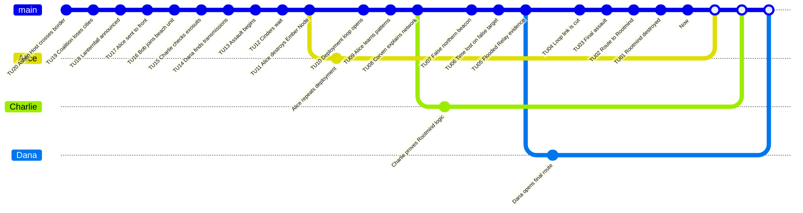

# Ashfall Battalion - Game Master Prep

This original scenario presents a tactical investigation in a war against a nonhuman collective intelligence called the Ashen Host.

## Premise

Eastern Europe has fallen. The coalition prepares Operation Lanternfall on the Black Salt Coast. The assault is a trap: the Cinders, sentinels of the Ashen Host, already know the plan. Alice destroys an Ember Node and becomes linked to the enemy `Counter-System`: when she dies, a `Branched Timeline` reopens on deployment morning.

The false target is a northern command beacon. The real source is the Rootmind hidden in the Flooded Relay.

## Core Game Master Truth

- The loop is not a personal power: it is a reaction of the enemy `Counter-System`.
- Cinders use previous failures as tactical data.
- Destroying the false beacon leaves the Rootmind intact.
- A transfusion or medical synchronization can sever Alice's loop link.
- Victory requires a final stable branch without reliance on an infinite reset.

## Main Timeline

| Time Unit | Visible or Discoverable Event |
|---:|---|
| 20 | The Ashen Host crosses the eastern border. |
| 19 | The coalition loses three cities. |
| 18 | General Iren announces Lanternfall. |
| 17 | Alice is sent to the front through a disciplinary mistake. |
| 16 | Bob joins the beach unit. |
| 15 | Charlie inspects the exosuits. |
| 14 | Dana identifies enemy transmissions. |
| 13 | The assault begins. |
| 12 | The Cinders are already waiting for the coalition. |
| 11 | Alice destroys an Ember Node. |
| 10 | The deployment loop opens. |
| 9 | Alice learns through repetition. |
| 8 | Doctor Corven explains the network. |
| 7 | The northern beacon is wrongly identified. |
| 6 | The group wastes time on the false target. |
| 5 | `Evidence` points toward the Flooded Relay. |
| 4 | Alice loses the loop link after treatment. |
| 3 | The final assault begins. |
| 2 | Dana opens a route to the Rootmind. |
| 1 | The Rootmind is destroyed or survives. |
| 0 | `Now`: the front stabilizes or collapses. |

## Hidden Causal Table

| ID | Conditions | Fact | Evidence |
|---|---|---|---|
| F01 | Simple: Lanternfall is public. | The enemy prepares an ambush. | Intercepted orders. |
| F02 | Dependency: F01. | Cinders massacre the first wave. | Helmet footage. |
| F03 | Dependency: F02. | Alice destroys an Ember Node. | Bioelectric trace. |
| F04 | Dependency: F03. | The `Counter-System` reopens the branch. | Retained memory. |
| F05 | Dependency: F04. | Alice accumulates tactical data. | Repetition notebook. |
| F06 | Simple: the northern beacon emits a signal. | A credible false target exists. | Radio spectrum. |
| F07 | Dependency: F05. | Corven identifies the Rootmind. | Underwater map. |
| F08 | Dependency: F07. | The group reaches the Flooded Relay. | Assault route. |
| F09 | Dependency: F08. | The Rootmind can be destroyed. | Explosive charge. |
| F10 | Dependency: F08 and F09. The relay pattern is reinterpreted. | The Flooded Relay is the true target. | Tide map, signal convergence. |
| F11 | Dependency: F10. The battalion enters the Relay. | The final no-reset assault begins. | Tide carrier log. |
| F12 | Dependency: F11. The Rootmind is destroyed while the Node-link cause remains explainable. | Victory on the Now can merge. | Collapsed Cinders, preserved Node ash. |

## Special Rule: Node-Link Loop

- Before sync surgery, Alice's death reopens deployment morning.
- Do not replay every death; each montage loop may reveal one Evidence, Condition, route, or conflict.
- Every three remembered deaths add a temporary -5 Mental Load penalty until the next clean merge.
- After sync surgery, death is final unless a scenario-specific merge explains survival.

## Characters

| Character | Role | Mental Load | Health | Rewind Dice |
|---|---|---:|---:|---|
| Alice | Loop Bearer | 0 | 10 | d4, d6, d8, d10, d12, d20 |
| Bob | Soldier Investigator | 0 | 10 | d4, d6, d8, d10, d12, d20 |
| Charlie | Scientist Investigator | 0 | 10 | d4, d6, d8, d10, d12, d20 |
| Dana | Intelligence Investigator | 0 | 10 | d4, d6, d8, d10, d12, d20 |
| Rootmind | Collective `Time Offender` | 0 | Conflict | `Counter-System` |
| Iren | Coalition command | 80 | 10 | None |
| Corven | Network physician | 70 | 10 | None |

## Reference Statistics

| Player | Branches | Merged | Minor Remaining | Major Remaining | Total Rewind | Notes |
|---|---:|---:|---:|---:|---:|---|
| Alice | 3 | 2 | 0 | 0 | 3 | The loop shows the danger but remains limited by the `Counter-System`. |
| Bob | 2 | 2 | 1 | 0 | 2 | Retains local military pressure. |
| Charlie | 2 | 2 | 0 | 0 | 2 | Stabilizes the true target. |
| Dana | 2 | 2 | 0 | 0 | 2 | Opens the final route. |

## GitGraph

White points correspond to `Merges` onto the `Now` on the `main` branch. The white square represents the `Now`.

