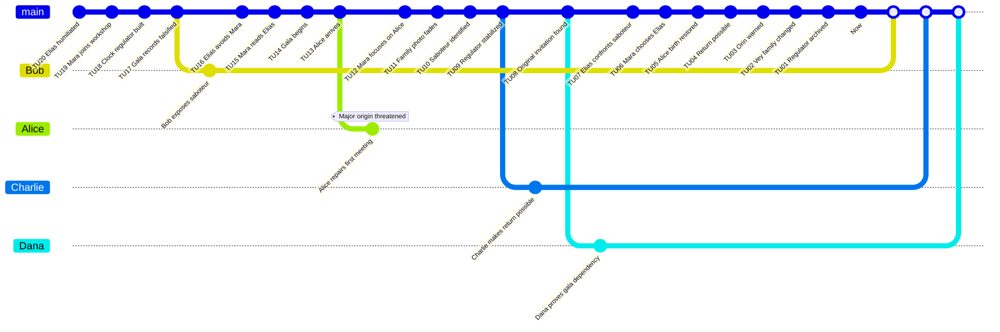

# The Clockmaker's Child - Game Master Prep

This original scenario explores a family-origin paradox without reusing protected characters, places, or objects.

## Premise

In 2008, Alice lives in a family worn down by failure. Her father Elias Vey abandoned writing after humiliation at the 1978 Foundry Gala. Her mother Mara Senn nevertheless chose him that evening in the `Main Timeline`. When inventor Orin Pell activates an experimental clock regulator, Alice is projected into a 1978 `Branched Timeline` and clumsily prevents her parents from meeting.

The `Investigators` must preserve Alice's birth, restore Elias's confidence, and bring back an improved but coherent `Main Timeline`.

## Main Timeline

| Time Unit | Visible or Discoverable Event |
|---:|---|
| 20 | Elias is humiliated in his youth. |
| 19 | Mara joins the neighborhood clockmaking workshop. |
| 18 | Orin Pell builds the clock regulator. |
| 17 | A saboteur falsifies the gala records. |
| 16 | Elias avoids Mara before the gala. |
| 15 | Mara reads a piece by Elias. |
| 14 | The gala begins. |
| 13 | Alice arrives in the 1978 branch. |
| 12 | Mara takes an interest in Alice instead of Elias. |
| 11 | Alice's family photograph fades. |
| 10 | Bob identifies the saboteur. |
| 9 | Charlie stabilizes the regulator. |
| 8 | Dana finds the original invitation. |
| 7 | Elias publicly confronts the saboteur. |
| 6 | Mara chooses Elias. |
| 5 | The gala kiss restores Alice's birth. |
| 4 | Returning to 2008 becomes possible. |
| 3 | Alice warns Orin of a future danger. |
| 2 | The Vey family becomes different but coherent. |
| 1 | The regulator joins the `System` case file. |
| 0 | `Now`: Alice still exists. |

## Hidden Causal Table

| ID | Conditions | Fact | Evidence |
|---|---|---|---|
| F01 | Simple: Elias lacks confidence. | He avoids Mara. | Notebook, witnesses. |
| F02 | Simple: Mara likes Elias's writing. | A relationship becomes possible. | Annotated letter. |
| F03 | Dependency: F01. | The saboteur can dominate him. | Falsified records. |
| F04 | Dependency: F02 and F03. | The gala is fragile. | Invitation. |
| F05 | Dependency: F04. | Alice interrupts the meeting. | Unstable family photograph. |
| F06 | Dependency: F05. | Alice's existence risks being erased. | Translucent hand, double memories. |
| F07 | Dependency: F03. | Elias confronts the saboteur. | Gala testimony. |
| F08 | Dependency: F07. | Mara chooses Elias. | Dance program. |
| F09 | Dependency: F08. | Alice can be `Merged` into a coherent `Now`. | Restored photograph. |

## Characters

| Character | Role | Mental Load | Health | Rewind Dice |
|---|---|---:|---:|---|
| Alice | Family-anchor Investigator | 0 | 10 | d4, d6, d8, d10, d12, d20 |
| Bob | Social Investigator | 0 | 10 | d4, d6, d8, d10, d12, d20 |
| Charlie | Technical Investigator | 0 | 10 | d4, d6, d8, d10, d12, d20 |
| Dana | Archive Investigator | 0 | 10 | d4, d6, d8, d10, d12, d20 |
| Elias Vey | Potential father | 80 | 10 | None |
| Mara Senn | Potential mother | 80 | 10 | None |
| Saboteur | Social antagonist | 90 | 10 | None or optional `Counter-System` |

## GitGraph

White points correspond to `Merges` onto the `Now` on the `main` branch. The white square represents the `Now`.

