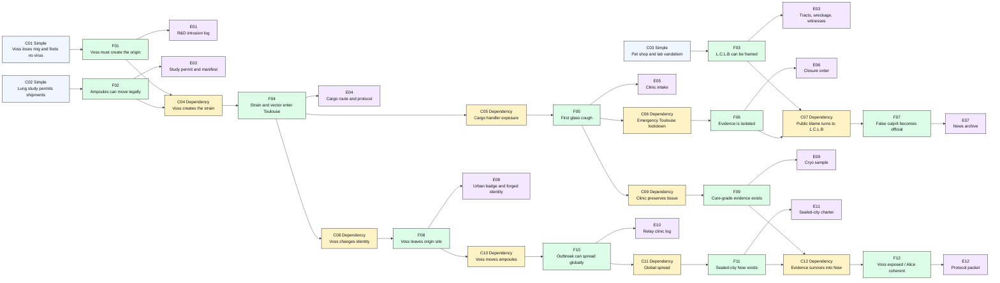
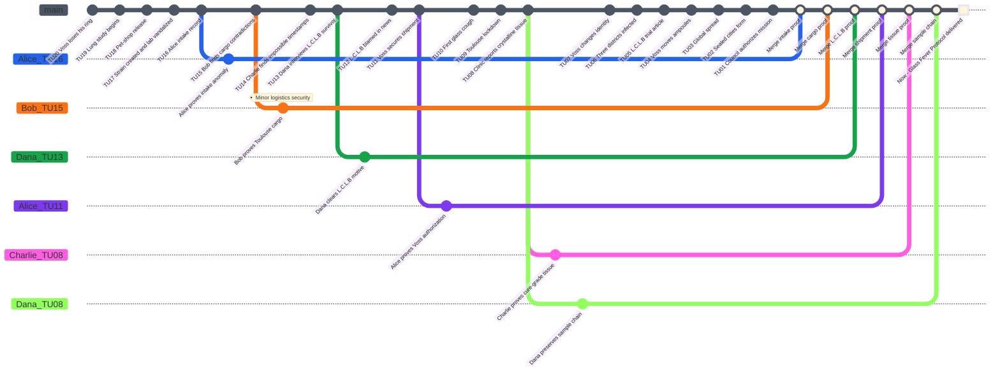
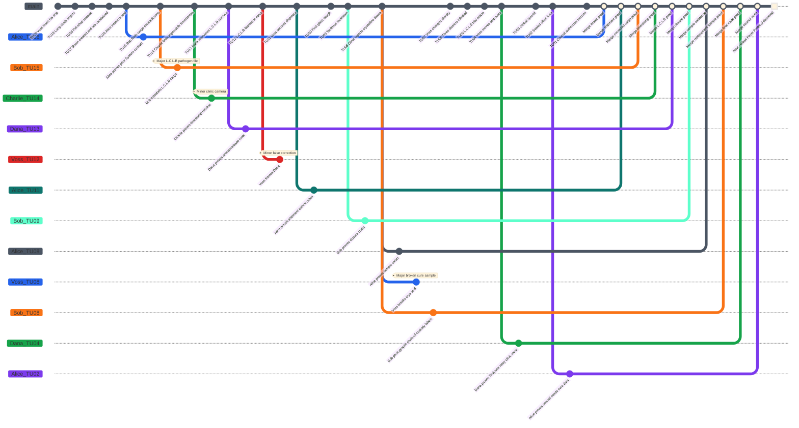

# Glass Fever Protocol - Game Master Prep

This original **Causality** scenario is recommended for beginners. It teaches the game twice: first as a starter investigation without active `Time Offender` pressure, then as a complete demonstration with Ilya Voss and his `Counter-System`.

## Table Validation

- Status: scenario played and confirmed playable.
- Tested configuration: 2 players, starter mode without a `Time Offender`.
- Observed duration: about 4 hours.
- Feedback: the players discovered the story without the GM playing an enemy taking adversarial actions during the session.

## Scenario Premise

In the `Now` of 2142, sealed cities still survive the consequences of Glass Fever, a lung-crystallization disease that appeared in Toulouse in 2117. The `Investigators` receive a simple mission: understand whether the epidemic was inevitable, identify its true source, and return with enough `Evidence` to stabilize a `Now` where a cure exists without erasing their reality.

The visible false culprit is **Les congénères de la liberation** (`L.C.L.B`), a small public-ritual and animal-liberation group formed around four Toulouse activists. The true culprit is Doctor Ilya Voss, a former biological virology expert who became the `Investigators'` physician because of the crisis and uses a `Counter-System` to protect his own origin.

The scenario is limited to Toulouse. Like causal depth, the `System's` spatial radius depends on available energy for reopening causal probabilities in spacetime. The `Investigators` may consult consequences from elsewhere, but only causes within Toulouse can be reopened, changed, and merged.

### The System and the Causality Gate in This Protocol

The [Causality setting foundation](../universe-and-system.md) states that time does not exist: Investigators perceive causal chains that the System can unwind and replay. This device combines a quantum computer with the mass and energy properties of a micro black hole, a fictional scientific application of the **general causality theorem**.

For this mission, the System opens a **Causality Gate** centered on the sealed cities' **Main Timeline**. The **Time Flow** is the accessible structure; **Branches**, also called **Branched Timelines**, allow examination and modification of the Toulouse causes of Glass Fever. Rings are control interfaces. **Rewind Dice** represent dark-energy capsules committed to attempting to open these Branches.

The Investigators must then perform a **Merge** onto the Main Timeline to rejoin the **Now** of 2142. An intervention may destroy cure evidence or the causes making the team itself possible. Experienced but unintegrated Branches increase cognitive load, measured by **Mental Load**, risking madness. The Toulouse radius, Rewind Dice costs, and scenario rules still apply.

## Core Game Master Truth

- `L.C.L.B` did not release the disease.
- `L.C.L.B` becomes visible at [TU18](#tu18), raiding a downtown Toulouse pet shop and releasing the caged animals.
- Its only actual connection to the virology R&D laboratory is vandalism at [TU17](#tu17), after Voss is hired: the group releases experimental animals and wrecks equipment.
- This action leads to an investigation and trial for trespass, vandalism, and animal release at [TU5](#tu05). It gives the public a credible but false reason to link `L.C.L.B` to the disease's origin.
- Voss is the true origin carrier.
- Voss is not initially an opportunistic criminal: he is a former virologist who recognizes an early viral form resembling his own work in a clue brought back by an `Investigator`.
- Voss creates his `Counter-System` to avoid identification by the organization, then returns to [TU20](#tu20) seeking the virus's original structure.
- At [TU20](#tu20), virology R&D archives contain no trace of an original virus. He understands that Glass Fever comes from the future, most likely from himself.
- At [TU17](#tu17), after joining the study, Voss accesses pulmonary-disease sampling shipments and creates the first strain using his virology expertise and research brought from the future.
- The quarantined fragment at [TU20](#tu20) is the `Counter-System` control ring Voss loses while fleeing laboratory guards. Without it, he cannot return to the `Now`.
- Alice is Voss's daughter. Her public file conceals the relationship under her mother's administrative surname, but degraded medical and genetic data can reveal it.
- The `System` can act only within the Toulouse spatial radius for this protocol. Any external clue must lead back to a Toulouse cause before becoming playable.
- In starter mode, Voss is only the hidden historical cause.
- In complete mode, Voss is an aware `Time Offender` seeking to preserve the sealed-city order.
- Glass Fever must remain explainable at final resolution, but the `Investigators` can expose Voss and preserve cure `Evidence`.
- Completely preventing the epidemic without a replacement cause may make the original `Now` incoherent.

## Lore

In 2142, sealed cities exist because Glass Fever devastated Toulouse twenty-five years earlier before becoming a global crisis. Public archives tell a simple story: `L.C.L.B` conducts breathing rituals and animal releases in Toulouse. Its first visible action is at [TU18](#tu18), when it raids a downtown pet shop and releases every caged animal ([I-TU18](#i-tu18), [F03](#f03)). The virology R&D laboratory participating in the pulmonary study also experiments on animals. After Voss is hired, `L.C.L.B` vandalizes the laboratory at [TU17](#tu17), releases experimental animals, and wrecks equipment. The intrusion targets animals and the laboratory, not pathogens ([I-TU17](#i-tu17), [F03](#f03)). Dana later interviews Ines Valcay, an `L.C.L.B` survivor familiar with symbols, cages, and releases but not pathogens ([TU13](#tu13), [I-TU13](#i-tu13), [F03](#f03)). Accusations against `L.C.L.B` then become the official catastrophe origin ([TU12](#tu12), [I-TU12](#i-tu12), [F07](#f07)). At [TU5](#tu05), a newspaper article revives the laboratory vandalism, investigation, and trial ([I-TU05](#i-tu05), [F07](#f07)). This account is false but useful to the `Now`: it gives the catastrophe a readable origin, protects Voss, and helps sealed cities justify their health authority.

The true origin is Doctor Ilya Voss. Before the sealed cities, he was a biological virology expert. In the `Now`, the crisis forces him to become the `Investigators'` physician. When an `Investigator` returns with a clue tied to an early Glass Fever form, Voss recognizes a signature resembling his earlier virology work. Realizing a personal link to the virus, he creates a `Counter-System` to evade identification by the organization, then returns to [TU20](#tu20) to find the pathogen's original structure.

At [TU20](#tu20), Voss infiltrates the virology R&D archives. The files contain no credible original virus: no parent strain, initial protocol, or earlier sample chain. He concludes that Glass Fever does not yet exist and comes from the future, almost certainly from his own work. Guards hear him in the quarantine room. While fleeing, he loses his `Counter-System` control ring, equivalent to the rings `Investigators` use to communicate with and control the `System`. It is confiscated as the laboratory's quarantined fragment ([I-TU20](#i-tu20), [F01](#f01)). Without it, he cannot return to the `Now`.

Trapped in the past, Voss understands that his reality depends on the catastrophe: without Glass Fever, sealed cities do not form ([TU02](#tu02), [I-TU02](#i-tu02), [F11](#f11)); he never meets his wife in a sealed city; Alice is never born; the council never authorizes the mission ([TU01](#tu01), [I-TU01](#i-tu01), [F12](#f12)); and Glass Fever Protocol never reaches the `Investigators` ([TU00](#tu00), [I-TU00](#i-tu00), [F12](#f12)).

Voss uses his knowledge of the `Main Timeline` to reproduce events instead of preventing them. Toulouse's health network launches a pulmonary study that creates a legal sample route ([TU19](#tu19), [I-TU19](#i-tu19), [F02](#f02)). The virology R&D laboratory participates and provides animal lung-tissue protocols. Voss waits for an entry point, joins the study at [TU17](#tu17) as logistics manager, and gains access to pulmonary-disease sampling shipments. Using his virology expertise and fragments of future research, he creates the first Glass Fever strain in the sampling chain ([I-TU17](#i-tu17), [F04](#f04)). The same `Time Unit` contains `L.C.L.B` vandalism: released experimental animals, open cages, damaged equipment, and activist traces. This creates judicial noise around the right place, but not the disease.

Unstable traces appear before the `Investigators` understand the case. Alice appears in a degraded intake file, evidence that the `System` has already touched the case and that her parentage has been concealed in the `Now` archives ([TU16](#tu16), [I-TU16](#i-tu16), [F12](#f12)). Charlie then notices impossible timestamps proving that `Counter-System` pressure protects the origin chain ([TU14](#tu14), [I-TU14](#i-tu14), [F01](#f01)).

In Toulouse, Bob finds contradictory cargo routes indicating an unstable logistics chain ([TU15](#tu15), [I-TU15](#i-tu15), [F02](#f02)). Voss then secures the medical shipment that becomes the true origin vector ([TU11](#tu11), [I-TU11](#i-tu11), [F04](#f04)). A cargo handler is exposed and develops the first glass cough ([TU10](#tu10), [I-TU10](#i-tu10), [F05](#f05)). Once symptoms cannot be hidden, an emergency order closes the affected Toulouse area, isolates evidence, and turns Toulouse into the official origin scene ([TU09](#tu09), [I-TU09](#i-tu09), [F06](#f06)).

The first clinic identifies crystalline lung tissue and preserves samples that can become cure `Evidence` ([TU08](#tu08), [I-TU08](#i-tu08), [F09](#f09)). Voss knows this `Evidence` threatens him if it reveals the true chain, but is essential if the `Investigators` are to stabilize a coherent `Now` rather than erase their reality. He changes his movement identity to leave the origin site without leaving the `System's` Toulouse radius ([TU07](#tu07), [I-TU07](#i-tu07), [F08](#f08)). He then moves the remaining ampoules through a Toulouse relay clinic, giving the epidemic its final route ([TU04](#tu04), [I-TU04](#i-tu04), [F10](#f10)).

Glass Fever reaches three Toulouse districts and makes the original `Now` likely ([TU06](#tu06), [I-TU06](#i-tu06), [F11](#f11)). Alice, Bob, Charlie, and Dana converge on Toulouse under security pressure ([TU05](#tu05), [I-TU05](#i-tu05), [F12](#f12)). Glass Fever then becomes global ([TU03](#tu03), [I-TU03](#i-tu03), [F11](#f11)). Sealed cities form under emergency rule ([TU02](#tu02), [I-TU02](#i-tu02), [F11](#f11)). Years later, their council authorizes Glass Fever Protocol ([TU01](#tu01), [I-TU01](#i-tu01), [F12](#f12)). In the `Now`, the `Investigators` receive the protocol: open the `Time Flow` within Toulouse, determine whether the epidemic was inevitable, identify the source, and return with enough `Evidence` to expose Voss without destroying the present that sent them ([TU00](#tu00), [I-TU00](#i-tu00), [F12](#f12)).

## Main Timeline

The `Time Flow` has exactly 20 `Atomic Time Units` before the `Now`. `Time Unit 20` is the oldest prepared state, `Time Unit 1` is closest to the present, and `Time Unit 0` is the `Now`. All playable units are anchored in Toulouse: going beyond the `System's` spatial radius costs too much energy to reopen a stable causal probability. Periods below are table references to help players imagine the setting, not fixed unit durations.

| Time Unit | Period | Visible or Discoverable Event | GM Note |
|---:|---|---|---|
| 20 | Spring 2116 | Voss infiltrates virology R&D archives. | No original virus trace; he loses his `Counter-System` control ring. |
| 19 | Summer 2116 | Toulouse's health network launches a pulmonary study. | Voss sees the legal sample route he needs. |
| 18 | Autumn 2116 | `L.C.L.B` raids a downtown pet shop and releases caged animals. | First visible group action; the false culprit becomes public. |
| 17 | Winter 2116-2117 | Voss joins the study, accesses sampling shipments, and creates the first strain; `L.C.L.B` vandalizes the virology R&D lab, releases experimental animals, and wrecks equipment. | Future research creates the strain; activism creates the judicial link used for false disease blame. |
| 16 | January 2117 | Alice appears in a degraded intake file. | The `System` has touched the case and concealed her relationship with Voss. |
| 15 | February 2117 | Bob finds contradictory cargo routes in Toulouse. | The ampoule route is unstable. |
| 14 | March 2117 | Charlie detects impossible timestamps. | `Counter-System` residue exists. |
| 13 | April 2117 | Dana interviews an `L.C.L.B` survivor. | The group knows symbols, not pathogens. |
| 12 | May 2117 | `L.C.L.B` is publicly accused. | This protects Voss. |
| 11 | June 2117 | Voss secures the medical shipment. | True origin vector. |
| 10 | July 2117 | A cargo handler develops the first glass cough. | First observable infection chain. |
| 9 | August 2117 | Toulouse enters local sanitary lockdown. | `Evidence` becomes difficult to access. |
| 8 | September 2117 | The first clinic reports crystalline lung tissue. | Cure `Evidence` exists here. |
| 7 | October 2117 | Voss changes his movement identity. | He starts watching the `Investigators`. |
| 6 | November 2117 | The epidemic reaches three Toulouse districts. | The original `Now` becomes likely. |
| 5 | December 2117 | The team converges on Toulouse; a news article revives the R&D vandalism, investigation, and trial of `L.C.L.B`. | Security pressure begins; the judicial false lead strengthens. |
| 4 | January 2118 | Voss moves ampoules through a Toulouse relay clinic. | Final carrier route. |
| 3 | Spring 2118 | Glass Fever becomes global. | Catastrophe locked. |
| 2 | 2119-2122 | Sealed cities form. | The future `System` can exist. |
| 1 | Early 2142 | The sealed-city council authorizes the mission. | Last prepared state before the `Now`. |
| 0 | Now, 2142 | The `Investigators` receive Glass Fever Protocol. | The present must remain coherent. |

### Main Timeline Mermaid Graph

```mermaid
flowchart LR
  TU20["TU20<br/>Voss loses his ring"] --> TU19["TU19<br/>Lung study begins"]
  TU19 --> TU18["TU18<br/>L.C.L.B pet-shop release"]
  TU18 --> TU17["TU17<br/>Strain created / lab vandalized"]
  TU17 --> TU16["TU16<br/>Alice intake record"]
  TU16 --> TU15["TU15<br/>Toulouse cargo conflicts"]
  TU15 --> TU14["TU14<br/>Impossible timestamps"]
  TU14 --> TU13["TU13<br/>L.C.L.B survivor interview"]
  TU13 --> TU12["TU12<br/>L.C.L.B blamed"]
  TU12 --> TU11["TU11<br/>Voss secures shipment"]
  TU11 --> TU10["TU10<br/>First glass cough"]
  TU10 --> TU09["TU09<br/>Toulouse closes"]
  TU09 --> TU08["TU08<br/>Clinic tissue report"]
  TU08 --> TU07["TU07<br/>Voss changes identity"]
  TU07 --> TU06["TU06<br/>Three districts infected"]
  TU06 --> TU05["TU05<br/>L.C.L.B trial article"]
  TU05 --> TU04["TU04<br/>Ampoules moved"]
  TU04 --> TU03["TU03<br/>Global spread"]
  TU03 --> TU02["TU02<br/>Sealed cities form"]
  TU02 --> TU01["TU01<br/>Council authorizes mission"]
  TU01 --> NOW["TU00 / Now<br/>Protocol delivered"]
```

## Initial Player Briefing

- The `Now` is 2142.
- Glass Fever officially begins in Toulouse in 2117.
- The `System` can reopen causal probabilities only within its Toulouse spatial radius; the scenario remains confined to the city.
- Public archives accuse `L.C.L.B`.
- `L.C.L.B` first raided a downtown pet shop, then vandalized a virology R&D lab tied to the pulmonary study. Early archives mention animals, wreckage, and a trial, not pathogens.
- Several archive timestamps are impossible.
- Ilya Voss appears in clean records but never in public accusations.
- The quarantined fragment resembles a `System` control ring but predates every official version of the device.
- Alice's medical file contains corrupted parentage fields and unresolved genetic markers.
- Identify the true origin, preserve cure `Evidence`, and avoid erasing the sealed-city `Now`.

## Clue Table

| ID | Time Unit | Clue | What It Reveals | Causal References |
|---|---:|---|---|---|
| I-TU20 | [TU20](#tu20) | R&D intrusion log tied to Voss, no original strain, quarantined `Counter-System` control ring. | Voss comes from the future, has lost return access, and understands the virus has no historical origin. | [F01](#f01) |
| I-TU19 | [TU19](#tu19) | Pulmonary study permit and transfer authorizations. | The study gives samples a legal route Voss can exploit to recreate the timeline. | [F02](#f02) |
| I-TU18 | [TU18](#tu18) | Pet-shop footage, animal-release leaflet, public `L.C.L.B` messages. | The group becomes visible through animal release, not virology. | [F03](#f03) |
| I-TU17 | [TU17](#tu17) | Voss's logistics contract, pulmonary sampling shipment notes, virology protocol fragments, internal lab vandalism report. | Future expertise creates the strain; `L.C.L.B` released animals and wrecked the lab without handling pathogens. | [F03](#f03), [F04](#f04) |
| I-TU16 | [TU16](#tu16) | Degraded intake file naming Alice, erased paternal identity, genetic markers compatible with Voss. | The `System` touched the case; Alice is Voss's daughter; the investigation is not neutral. | [F12](#f12) |
| I-TU15 | [TU15](#tu15) | Toulouse cargo manifest with contradictory routes. | The ampoule route is unstable and can be manipulated. | [F02](#f02), [F04](#f04) |
| I-TU14 | [TU14](#tu14) | Impossible timestamps in clinical and logistics archives. | `Counter-System` intervention protects the origin chain. | [F01](#f01), [F04](#f04) |
| I-TU13 | [TU13](#tu13) | Ines Valcay's testimony about Malo, the group's formation, pet shop, and lab vandalism. | `L.C.L.B` knows symbols, cages, wreckage, and animal release, not pathogens. | [F03](#f03) |
| I-TU12 | [TU12](#tu12) | News archive and arrest report accusing `L.C.L.B`. | The false culprit becomes official and protects Voss. | [F07](#f07) |
| I-TU11 | [TU11](#tu11) | Voss-signed shipment authorization, route, missing seal. | Voss secures the true origin vector. | [F04](#f04) |
| I-TU10 | [TU10](#tu10) | Clinic intake and exposed cargo handler's testimony. | The first glass cough follows the shipment, not `L.C.L.B` actions. | [F05](#f05) |
| I-TU09 | [TU09](#tu09) | Toulouse sanitary lockdown order and security log. | Closure isolates `Evidence`. | [F06](#f06) |
| I-TU08 | [TU08](#tu08) | Clinical report, Ren Arco's cryo register, pathologist's note. | Cure `Evidence` exists. | [F09](#f09), [F12](#f12) |
| I-TU07 | [TU07](#tu07) | Urban movement badge and Voss's forged identity. | Voss leaves the origin site without leaving Toulouse. | [F08](#f08) |
| I-TU06 | [TU06](#tu06) | Health report on three infected Toulouse districts. | The original `Now` becomes likely. | [F11](#f11) |
| I-TU05 | [TU05](#tu05) | Security records placing the team in Toulouse; article about `L.C.L.B` lab vandalism, investigation, and trial. | Security pressure surrounds the team and the judicial false lead strengthens. | [F07](#f07), [F12](#f12) |
| I-TU04 | [TU04](#tu04) | Toulouse relay-clinic log and broken ampoule case. | Remaining ampoules move onto the final propagation route. | [F10](#f10) |
| I-TU03 | [TU03](#tu03) | Global Glass Fever health bulletin. | The catastrophe is locked worldwide. | [F11](#f11) |
| I-TU02 | [TU02](#tu02) | Sealed-city charter and population record. | The sealed-city `Now` depends on the epidemic. | [F11](#f11) |
| I-TU01 | [TU01](#tu01) | Sealed-city council authorization. | The mission can begin without making the `Now` incoherent. | [F12](#f12) |
| I-TU00 | [TU00](#tu00) | Final Glass Fever Protocol packet and sample chain. | The team can expose Voss if `Evidence` survives. | [F12](#f12) |

## Hidden Causal Table

| ID | Condition Type | Conditions | Fact | Evidence |
|---|---|---|---|---|
| F01 | Simple | At TU20, Voss finds no original strain and loses his `Counter-System` control ring. | Voss understands he must create the origin from the future to preserve his reality. | [I-TU20](#i-tu20) Intrusion log, absent strain, quarantined ring. |
| F02 | Simple | The pulmonary study permits medical shipments. | Contaminated ampoules can circulate legally if Voss controls logistics. | [I-TU19](#i-tu19) Study permit; [I-TU15](#i-tu15) manifest. |
| F03 | Simple | `L.C.L.B` raids a pet shop, releases animals, then vandalizes the virology R&D lab against animal experimentation. | The group can be tried for trespass and damage, but its lab link is activist, not virological. | [I-TU18](#i-tu18) Pet shop, leaflet, messages; [I-TU17](#i-tu17) vandalism report; [I-TU13](#i-tu13) Ines's testimony. |
| F04 | Dependency | Dependency: [F01](#f01) and [F02](#f02). Voss takes the logistics job, accesses sampling shipments, and creates the strain using future research. | The true origin vector enters Toulouse. | [I-TU17](#i-tu17) Handling notes and protocol; [I-TU11](#i-tu11) secured shipment. |
| F05 | Dependency | Dependency: [F04](#f04). The cargo handler is exposed. | The first glass cough begins. | [I-TU10](#i-tu10) Clinic intake, handler's testimony. |
| F06 | Dependency | Dependency: [F05](#f05). The emergency order closes the Toulouse area. | `Evidence` is isolated. | [I-TU09](#i-tu09) Closure order, security log. |
| F07 | Dependency | Dependency: [F03](#f03) and [F06](#f06). Public blame targets `L.C.L.B`, recycling R&D vandalism. | The false culprit becomes official. | [I-TU12](#i-tu12) News and arrest report; [I-TU05](#i-tu05) article, investigation, trial. |
| F08 | Dependency | Dependency: [F04](#f04). Voss changes his movement identity. | Voss leaves the origin site without leaving Toulouse. | [I-TU07](#i-tu07) Urban badge, forged identity. |
| F09 | Dependency | Dependency: [F05](#f05). The clinic preserves tissue. | Cure `Evidence` exists. | [I-TU08](#i-tu08) Clinical report, cryo sample. |
| F10 | Dependency | Dependency: [F08](#f08). Voss moves the ampoules. | The epidemic can leave the Toulouse radius and spread globally. | [I-TU04](#i-tu04) Relay-clinic log, broken case. |
| F11 | Dependency | Dependency: [F10](#f10). Global spread occurs. | The sealed-city `Now` exists. | [I-TU06](#i-tu06) Three districts; [I-TU03](#i-tu03) global bulletin; [I-TU02](#i-tu02) charter. |
| F12 | Dependency | Dependency: [F09](#f09) and [F11](#f11). `Evidence` survives into the `Now` and Alice's file remains coherent. | The team can expose Voss without erasing the `Now` or denying Alice's birth. | [I-TU16](#i-tu16) Degraded file; [I-TU01](#i-tu01) authorization; [I-TU00](#i-tu00) protocol packet. |

### Causal Table Mermaid Graph

## Key Characters

| Character | Public Role | Real Function |
|---|---|---|
| Alice | Medical Investigator | Voss's concealed daughter, System-contact anchor, medical evidence. |
| Bob | Logistics Investigator | Follows routes, security, shipment contradictions. |
| Charlie | Technical Investigator | Reads timestamps and `Counter-System` traces. |
| Dana | Social Investigator | Clears `L.C.L.B` and preserves `Evidence`. |
| Ilya Voss | Former virologist, `Investigators'` physician | `Counter-System` creator, `Time Offender`, true carrier in complete mode. |
| Les congénères de la liberation (`L.C.L.B`) | Animal-liberation and public-ritual group | False culprit. |
| Malo Keravec | Vegetarian `L.C.L.B` leader in his thirties, failed former student. | Seeks a chance to become someone through the movement. |
| Ines Valcay | Activist, 25, Malo's former partner. | Deeply involved, still in love, but no longer deceived about him. |
| Lila Nouri | Young student recruited by Malo. | His new romantic conquest, fascinated by his rhetoric. |
| Basile Ferran | Quiet, perceptive student long ignored. | Glad finally to join a group giving him a place. |
| Sera Holt | First known patient | Human proof of the exposure chain. |
| Ren Arco | Pathologist | Keeps the sample useful for a cure. |

## L.C.L.B Core

L.C.L.B forms around Malo Keravec, a vegetarian activist in his thirties and a failed student who never found a durable social status. He turns his frustration into animal-liberation rhetoric and sees the group as a chance to become someone: a founder, a guide, a public face.

Ines Valcay joins first out of conviction, then stays because of her attachment to Malo. She is 25, knows his manipulations, and no longer has illusions about him, but still loves him enough to protect the group when the archives start blaming it. Lila Nouri arrives later, younger and still a student, drawn to Malo's rhetoric and the romantic image of the movement. Basile Ferran completes the core: quiet, intelligent, used to being alone and ignored, and willing to accept too much because L.C.L.B is the first group that gives him a place.

Their first visible action happens in Time Unit 18: they raid a downtown Toulouse pet shop and release every caged animal. The action gives the group a public identity, surveillance footage, tracts, and an activist signature. It creates no pathogen link, but it prepares the confusion that later makes blame against L.C.L.B credible.

## Contamination Risk

When an Investigator enters a Time Unit where the Glass Fever is known to be present, the GM asks for a contamination test with the percentile d10. In this scenario, that mainly applies to Time Units 10, 9, 8, 6, 4, and 3. The GM can also apply it to Time Units 7, 5, 2, or the Now if the scene directly exposes the character to an open infectious zone, patient, sample, or contaminated ampoules.

Use the threshold according to exposure:

| Exposure | Threshold |
|---|---:|
| Brief scene with plausible precautions | Easy `20` |
| Clinic scene, contaminated district, or indirect contact | Average `50` |
| Direct contact with patient, crystalline tissue, ampoule, or broken seal | Hard `70` |

The character's Mental Load is subtracted from the raw percentile result, as with other percentage action rolls. On success, the character is not contaminated. On failure, mark **Contaminated - Glass Fever** as a personal Minor Conflict. This conflict can be resolved through quarantine, medical protocol, Evidence of non-exposure, branch correction, or a coherent replacement cause.

As long as an Investigator is contaminated, they must make a health test with the percentile d10 for every significant action. The threshold is normally average `50`, or hard `70` for physical action, flight, combat, a contaminated atmosphere, or sample handling. On failure, the disease impacts Health: the GM rolls `d4` damage, or `d6` if the action was difficult or violent.

If a contaminated Investigator returns to a Time Unit where the disease is not present, especially Time Units 20 through 11, every meaningful encounter with an unprotected person requires a transmission test with the percentile d10. Use easy `20` for a short interaction, average `50` for close conversation or an enclosed space, and hard `70` for physical, medical, or prolonged contact. On failure, the encountered person is contaminated and the GM notes **Anachronistic infection** as a branch conflict. If that infection affects a key NPC or remains unresolved at Merge, it becomes a Major Conflict because the Investigators introduced Glass Fever before its origin chain.

## Doctor Voss as Time Offender

Voss begins **Unaware of identities**, becomes **Alerted** when the group touches Toulouse logistics records, and reaches **Identified target** when an Investigator reveals impossible knowledge of the ampoule route.

His personal motivation is simple: without the epidemic, he never meets his wife in a sealed city and Alice never exists. Trapped after losing his control ring at [TU20](#tu20), he cannot return to correct events from the Now. He must replay the catastrophe with historically available means.

Voss avoids targeting Alice directly while he can interpret her actions as recoverable. If he understands she will accept erasing the chain that produces her birth, he may treat her as an identified target, but actions against her must leave emotional traces: an unsigned parental message, hesitation in an edited archive, or a security order canceled and reactivated.

Voss has one single-use **Counter-System Rewind Dice** set: d4, d6, d8, d10, d12, d20.

| Action | Mechanical Effect | Evidence Left Behind |
|---|---|---|
| Reframe L.C.L.B | Add one Minor Conflict to an Investigator clearing L.C.L.B. | Edited news archive. |
| Move ampoules | Force a corrective branch or keep a Major Conflict. | Relay-clinic route mismatch. |
| Contaminate clinic sample | Block one merge until replacement evidence exists. | Broken cryo seal. |
| Identify an Investigator | Add public security pressure. | Watchlist entry. |

## Rewind Dice Trackers

Use these tables during play. Mark a die as spent immediately when an Investigator or Time Offender opens a Branched Timeline with it.

| Investigator | d4 | d6 | d8 | d10 | d12 | d20 |
|---|---|---|---|---|---|---|
| Alice | available | available | available | available | available | available |
| Bob | available | available | available | available | available | available |
| Charlie | available | available | available | available | available | available |
| Dana | available | available | available | available | available | available |

| Time Offender | d4 | d6 | d8 | d10 | d12 | d20 |
|---|---|---|---|---|---|---|
| Ilya Voss | available | available | available | available | available | available |

## Starter Playthrough - Without Time Offender

Use this version first when teaching the scenario. Voss is only the historical source in this version. Ignore Counter-System dice, Time Offender awareness states, and Time Offender actions. The table still uses the normal turn order: GM, Alice, Bob, Charlie, Dana.

### Starter Replay Log

**GM turn.** The GM opens the Time Flow at Now. The visible briefing says L.C.L.B is blamed, Toulouse is the first known outbreak site, the System radius limits interventions to the city, and the archive contains impossible timestamps. The GM keeps Voss hidden as the true carrier.

**Alice turn.** Alice spends her d20 to target Time Unit `16`. Forced teaching value: `d20 -> 13`, so `r = 13 / 16 x 100 = 81.25%`: critical success. Alice proves that her degraded intake file comes from earlier System contact and contains deliberately erased paternal identity. In starter mode, the GM may conceal Voss's name until final resolution. The branch can merge immediately because it does not contradict any dependency. Alice ends at `0` Mental Load.

**Bob turn.** Bob spends his d12 to target Time Unit `15`. Forced teaching value: `d12 -> 8`, so `r = 53.33%`: partial success. Consequence `d10 -> 8`: Minor Conflict. Bob proves that the medical cargo route passed through Toulouse, but a logistics security report places an Investigator near a restricted manifest terminal. Bob has one non-Merged branch and one unresolved Minor Conflict: `30 + 20 = 50` Mental Load.

**Charlie turn.** Charlie spends his d10 to target Time Unit `14`. Forced teaching value: `d10 -> 4`, so `r = 28.57%`: partial failure. No stable Branched Timeline opens and the d10 is spent. Gain `d10 -> 5`: the GM reveals one Evidence direction, a timestamp pattern tied to the clinic archive. Charlie has no open branch and stays at `0` Mental Load.

**Dana turn.** Dana spends her d20 to target Time Unit `13`. Forced teaching value: `d20 -> 11`, so `r = 84.62%`: critical success. Dana interviews Ines Valcay and proves that the group formed around Malo Keravec, the pet-shop release, and animal-liberation rituals, not pathogen handling. The testimony confirms that the R&D lab vandalism targeted laboratory animals and equipment, not the pathogen chain. The branch merges and Dana ends at `0` Mental Load.

**GM turn.** The GM states the visible dependencies: the cargo route must be proven before Voss can be connected to the outbreak, and clinic samples must be preserved before a cure-grade Evidence chain can survive into the Now.

**Alice turn.** Alice spends her d12 to target Time Unit `11`. Forced teaching value: `d12 -> 8`, so `r = 72.73%`: partial success. Consequence `d10 -> 4`: wrong entry point. Alice enters the study office instead of the logistics terminal, but still proves Voss signed the medical shipment authorization. The sampling appendix points back to a Time Unit `17` protocol compatible with the first strain. The branch stays open until another Investigator confirms the sample chain. Alice has one non-Merged branch: `30` Mental Load.

**Bob turn.** Bob tries to resolve his logistics security Minor Conflict at easy difficulty. His current Mental Load is `50`, so forced percentile `70` gives a final result of `70 - 50 = 20`, meeting the easy threshold `20`: success. The security report becomes an anonymous maintenance alert, Bob's branch merges, and Bob returns to `0` Mental Load.

**Charlie turn.** Charlie spends his d12 to target Time Unit `14` and follow the timestamp pattern. Forced teaching value: `d12 -> 11`, so `r = 78.57%`: partial success. Consequence `d10 -> 6`: the branch opens closer to the Now than planned. The target moves from Time Unit `14` to Time Unit `8` because `14 - 6 = 8`. Charlie misses the archive terminal but reaches the first clinic report and proves cure-grade crystalline tissue exists. TU8 contains known clinical exposure: average contamination test, forced percentile `80`, success. Charlie has one non-Merged branch: `30` Mental Load.

**Dana turn.** Dana spends her d10 to target Time Unit `8`. Forced teaching value: `d10 -> 9`, so `r = 112.5%`: critical success. Dana preserves the clinic sample chain and links Ren Arco's cryo sample to Alice's Voss shipment proof. Because she handles clinical Evidence, she makes a hard contamination test; forced percentile `90`, success. The GM allows Alice's TU11 branch and Charlie's TU8 branch to merge. Alice, Charlie, and Dana return to `0` Mental Load.

**Final GM resolution.** The group has cleared L.C.L.B, proven Voss created the first strain through the shipment chain, and preserved cure-grade evidence. If the GM reveals Alice's parentage in this version, it becomes intimate proof of the paradox: the epidemic still exists, so both the sealed-city Now and Alice remain coherent. The ending is **complete starter convergence**.

### Starter Scenario GitGraph

In this GitGraph, every white point on the `main` branch corresponds to a merge on the Now. The white square represents the Now itself.

### Starter Final Play State

| Investigator | Final Mental Load | Final Health | Rewind Dice Spent | Open Conflicts | Final State |
|---|---:|---:|---|---:|---|
| Alice | 0 | 10 | d20, d12 | 0 | System contact, concealed parentage, and Voss authorization merged. |
| Bob | 0 | 10 | d12 | 0 | Cargo route merged after resolving the logistics report. |
| Charlie | 0 | 10 | d10, d12 | 0 | Timestamp failure becomes a clinic Evidence route. |
| Dana | 0 | 10 | d20, d10 | 0 | L.C.L.B cleared and clinic sample preserved. |

### Starter Player Statistics

These statistics keep resolution action rolls only. Contamination tests shown in the replay are separate scenario tests.

| Investigator | Total Branched Timelines | Merged Branched Timelines | Open Branched Timelines | Minor Conflicts Created | Minor Conflicts Resolved | Major Conflicts Created | Major Conflicts Resolved | Rewind Dice Spent | Critical Successes | Partial Successes | Partial Failures | Critical Failures | Percentage Action Rolls | Percentage Action Successes | Highest Mental Load | Final Health |
|---|---:|---:|---:|---:|---:|---:|---:|---:|---:|---:|---:|---:|---:|---:|---:|---:|
| Alice | 2 | 2 | 0 | 0 | 0 | 0 | 0 | 2 | 1 | 1 | 0 | 0 | 0 | 0 | 30 | 10 |
| Bob | 1 | 1 | 0 | 1 | 1 | 0 | 0 | 1 | 0 | 1 | 0 | 0 | 1 | 1 | 50 | 10 |
| Charlie | 1 | 1 | 0 | 0 | 0 | 0 | 0 | 2 | 0 | 1 | 1 | 0 | 0 | 0 | 30 | 10 |
| Dana | 2 | 2 | 0 | 0 | 0 | 0 | 0 | 2 | 2 | 0 | 0 | 0 | 0 | 0 | 0 | 10 |
| **Total** | **6** | **6** | **0** | **1** | **1** | **0** | **0** | **7** | **3** | **3** | **1** | **0** | **1** | **1** | **50** | **40** |

## Complete Playthrough - With Time Offender

Use this version after the starter replay. It intentionally demonstrates the full rules surface: all four Rewind outcomes, forced teaching dice values where useful, partial-success consequences, partial-failure gains, Minor Conflicts, Major Conflicts, cross-player conflict correction, percentage action rolls, damage without attack rolls, Time Offender awareness, and Counter-System actions.

### Complete Replay Log

**GM turn.** The GM opens the Time Flow and secretly marks Doctor Ilya Voss as a Time Offender with a Counter-System. Voss starts **Unaware of identities**. The GM keeps the following chain hidden: absence of an original strain in TU20, the lost command ring, Voss's sampling shipment access, first strain creation, first infection, evidence isolation, false public blame, final ampoule movement, and sealed-city Now.

**Alice turn.** Alice spends her d20 to target Time Unit `16`. Forced teaching value: `d20 -> 17`, so `r = 106.25%`: critical success. Alice proves her degraded file, prior System contact, and erased paternal identity whose markers point toward Voss. The branch remains open while the group checks whether the old System contact helps or threatens Voss's origin chain. Alice ends at `30` Mental Load.

**Bob turn.** Bob spends his d12 to target Time Unit `15`. Forced teaching value: `d12 -> 6`, so `r = 40%`: partial failure. No stable branch opens. Gain `d10 -> 6`: the GM reveals that one cargo manifest line has been moved closer to the Now by an unknown edit. Bob has no open branch and stays at `0` Mental Load.

**Charlie turn.** Charlie spends his d10 to target Time Unit `14`. Forced teaching value: `d10 -> 1`, so `r = 7.14%`: critical failure. No branch opens, no gain is rolled, and the d10 is spent. Charlie stays at `0` Mental Load.

**Dana turn.** Dana spends her d8 to target Time Unit `13`. Forced teaching value: `d8 -> 5`, so `r = 38.46%`: partial failure. No stable branch opens. Gain `d10 -> 7`: Time Offender trace. The GM reveals that L.C.L.B witness remembers a clean medical badge in the crowd, not only ritual symbols. Dana stays at `0` Mental Load.

**GM turn.** Voss notices the System pressure around the Toulouse cargo line and becomes **Alerted**. He does not know any Investigator identity yet, so he takes no targeted Counter-System action.

**Alice turn.** Alice spends her d12 to target Time Unit `11`. Forced teaching value: `d12 -> 9`, so `r = 81.82%`: critical success. She proves Voss signed the medical shipment, that the signature depends on the lung study permit, and that the sampling appendix points to the strain protocol created in Time Unit `17`. Alice merges her intake and shipment branches because they now preserve the origin chain. Alice returns to `0` Mental Load.

**Bob turn.** Bob spends his d20 to target Time Unit `15`. Forced teaching value: `d20 -> 9`, so `r = 60%`: partial success. Consequence `d10 -> 10`: Major Conflict. Bob proves the cargo route, but his first action makes the authorities classify L.C.L.B as a pathogen-smuggling group because the R&D lab vandalism is attached to the same lung study. The branch cannot merge until another cause clears L.C.L.B. Bob has one non-Merged branch and one unresolved Major Conflict: `30 + 40 = 70` Mental Load.

**Charlie turn.** Charlie spends his d12 to target Time Unit `14`. Forced teaching value: `d12 -> 8`, so `r = 57.14%`: partial success. Consequence `d10 -> 8`: Minor Conflict. Charlie proves Counter-System timestamp residue, but a clinic camera places him near the archive terminal. Charlie has one non-Merged branch and one unresolved Minor Conflict: `30 + 20 = 50` Mental Load.

**Dana turn.** Dana spends her d20 to target Time Unit `13`. Forced teaching value: `d20 -> 18`, so `r = 138.46%`: critical success. Dana proves Ines Valcay saw animal-release tools, opened cages, wrecked equipment, and vivarium files, not pathogen equipment. This creates the corrective cause that resolves Bob's Major Conflict: L.C.L.B vandalized the lab, but not the virus. Bob's branch can merge, and Bob returns to `0` Mental Load. Dana's branch also merges.

**GM turn.** Voss identifies Dana because she revealed impossible knowledge of the witness memory. He spends his Counter-System d8 to target Time Unit `12`. Forced teaching value: `d8 -> 6`, so `r = 50%`: partial success. Consequence `d10 -> 8`: Minor Conflict. Voss edits a news archive so Dana appears as the source of a false correction about the lab vandalism. Dana has one unresolved Minor Conflict and no open branch, so her Mental Load is `20`.

**Alice turn.** Alice spends her d8 to target Time Unit `8`. Forced teaching value: `d8 -> 5`, so `r = 62.5%`: partial success. Consequence `d10 -> 4`: wrong entry point. Alice enters the clinic after the sample freezer alarm, but she still proves that Ren Arco preserved crystalline tissue. TU8 contains known clinical exposure: average contamination test, forced percentile `80`, success. Alice has one non-Merged branch: `30` Mental Load.

**Bob turn.** Bob spends his d10 to target Time Unit `9`. Forced teaching value: `d10 -> 9`, so `r = 100%`: critical success. Bob proves the emergency closure chain and creates a lawful reason why the sample room remained sealed. TU9 is under emergency closure: easy contamination test with precautions, forced percentile `60`, success. This supports Alice's clinic branch but does not yet resolve Charlie's camera conflict. Bob's branch merges and he stays at `0` Mental Load.

**Charlie turn.** Charlie attempts to resolve the clinic camera Minor Conflict at average difficulty. His current Mental Load is `50`, so forced percentile `40` gives a final result of `40 - 50 = -10`, below the average threshold `50`: failure. The camera still identifies him, his branch cannot merge, and Charlie remains at `50` Mental Load.

**Dana turn.** Dana attempts to resolve Voss's archive frame at average difficulty because another Investigator has already exposed the cargo pattern. Her current Mental Load is `20`, so forced percentile `70` gives a final result of `70 - 20 = 50`, meeting the average threshold `50`: success. The false correction becomes an anonymous disputed edit, the Minor Conflict resolves, and Dana returns to `0` Mental Load.

**GM turn.** Voss escalates. He spends his Counter-System d12 to target Time Unit `8`. Forced teaching value: `d12 -> 10`, so `r = 125%`: critical success. He opens a branch where the cryo sample seal is broken before Alice can preserve it. He does not attack her directly yet: he tries to block evidence that could lead his own daughter to erase the catastrophe that caused her birth. This creates **Major broken cure sample**, a Major Conflict that blocks final convergence until replacement Evidence exists.

**Alice turn.** Alice spends her d6 to target Time Unit `8` and tries to preserve the original sample directly. Forced teaching value: `d6 -> 4`, so `r = 50%`: partial success. Consequence `d10 -> 6`: the branch opens closer to the Now than planned. The target moves from Time Unit `8` to Time Unit `2` because `8 - 6 = 2`. Alice misses the clinic but proves the sealed-city council needs cure-grade origin data. Alice now has two non-Merged branches and one unresolved Major Conflict: `60 + 40 = 100`. At the end of her turn, Alice falls into madness and can no longer maintain coherence with the observable Now.

**Bob turn.** Bob spends his d4 to target Time Unit `8`. Forced teaching value: `d4 -> 4`, so `r = 50%`: partial success. Consequence `d10 -> 3`: pursuit. Bob reaches the clinic sample room, finds the broken cryo seal, and creates replacement Evidence by photographing the chain-of-custody labels before security catches him. Direct contact with a broken seal requires a hard contamination test; forced percentile `80`, success. A guard strikes him with a nonlethal baton. No attack roll is made; the GM rolls only damage: `d6 -> 4`. Bob drops from `10` to `6` Health. Bob's replacement Evidence resolves Alice's Major Conflict and lets Alice's clinic branch merge, but Alice remains mad.

**Charlie turn.** Charlie tries the clinic camera Minor Conflict again at easy difficulty because Bob's replacement Evidence has weakened Voss's camera chain. His current Mental Load is `50`, so forced percentile `90` gives a final result of `90 - 50 = 40`, beating the easy threshold `20`: success. The camera record becomes incomplete, Charlie's timestamp branch merges, and Charlie returns to `0` Mental Load.

**Dana turn.** Dana spends her d10 to target Time Unit `4`. Forced teaching value: `d10 -> 8`, so `r = 200%`: critical success. Dana proves Voss moved the ampoules through the Toulouse relay clinic by connecting badge data, baggage Evidence, and the broken ampoule case. The broken case requires a hard contamination test; forced percentile `85`, success. Her branch merges.

**Final GM resolution.** The group exposes Voss as creator of the first strain, clears L.C.L.B, preserves replacement cure Evidence, and keeps the outbreak explainable. The final revelation confirms that Alice is Voss's daughter: exposing Voss must not erase the sealed cities, or Alice becomes incoherent too. Alice's Health remains `10`, but her final Mental Load is `100` because she reached madness during the unresolved sample conflict and never recovered coherence. The ending is **complete convergence with one Investigator mentally lost**.

### Complete Scenario GitGraph

In this GitGraph, every white point on the `main` branch corresponds to a merge on the Now. The white square represents the Now itself.

### Complete Final Play State

| Investigator | Final Mental Load | Final Health | Rewind Dice Spent | Open Conflicts | Final State |
|---|---:|---:|---|---:|---|
| Alice | 100 | 10 | d20, d12, d8, d6 | 0 | Voss's daughter; madness after reaching 100 Mental Load during the sample conflict. |
| Bob | 0 | 6 | d12, d20, d10, d4 | 0 | Resolves L.C.L.B Major Conflict and creates replacement sample Evidence. |
| Charlie | 0 | 10 | d10, d12 | 0 | Resolves the clinic-camera Minor Conflict and merges timestamp proof. |
| Dana | 0 | 10 | d8, d20, d10 | 0 | Clears L.C.L.B, defeats Voss's frame, and proves the final route. |

### Complete Player Statistics

These statistics keep resolution action rolls only. Contamination tests shown in the replay are separate scenario tests.

| Investigator | Total Branched Timelines | Merged Branched Timelines | Open Branched Timelines | Minor Conflicts Created | Minor Conflicts Resolved | Major Conflicts Created | Major Conflicts Resolved | Rewind Dice Spent | Critical Successes | Partial Successes | Partial Failures | Critical Failures | Consequence Rolls | Gain Rolls | Percentage Action Rolls | Percentage Action Successes | Highest Mental Load | Final Health |
|---|---:|---:|---:|---:|---:|---:|---:|---:|---:|---:|---:|---:|---:|---:|---:|---:|---:|---:|
| Alice | 4 | 4 | 0 | 0 | 0 | 1 | 1 | 4 | 2 | 2 | 0 | 0 | 2 | 0 | 0 | 0 | 100 | 10 |
| Bob | 3 | 3 | 0 | 0 | 0 | 1 | 1 | 4 | 1 | 2 | 1 | 0 | 2 | 1 | 0 | 0 | 70 | 6 |
| Charlie | 1 | 1 | 0 | 1 | 1 | 0 | 0 | 2 | 0 | 1 | 0 | 1 | 1 | 0 | 2 | 1 | 50 | 10 |
| Dana | 2 | 2 | 0 | 1 | 1 | 0 | 0 | 3 | 2 | 0 | 1 | 0 | 0 | 1 | 1 | 1 | 20 | 10 |
| **Total** | **10** | **10** | **0** | **2** | **2** | **2** | **2** | **13** | **5** | **5** | **2** | **1** | **5** | **2** | **3** | **2** | **0** | **36** |

Counter-System statistics:

| Time Offender | Counter-System Dice Spent | Stable branches opened | Minor Conflicts Created | Major Conflicts Created | Critical Successes | Partial Successes | Partial Failures | Critical Failures | Final Counter-System Note |
|---|---:|---:|---:|---:|---:|---:|---:|---:|---|
| Ilya Voss | d8, d12 | 2 | 1 | 1 | 1 | 1 | 0 | 0 | Identifies Dana, frames her, breaks the sample seal, then loses to replacement Evidence. |

### Complete Mechanics Coverage

| Mechanic | Where it is played |
|---|---|
| Main Timeline vs hidden causal table | The GM reveals playable Facts while keeping Voss's Time Offender role hidden until Evidence exposes it. |
| Simple Condition | L.C.L.B pet-shop release, R&D lab vandalism, study permit, absence of an original strain, and Voss's lost ring. |
| Dependency Condition | Voss shipment access and first-strain creation precede cargo-handler exposure; clinic sample survival plus sealed-city Now permits safe exposure. |
| Critical Rewind success | Alice `d20 -> 17`, Alice `d12 -> 9`, Bob `d10 -> 9`, Dana `d20 -> 18`, Dana `d10 -> 8`. |
| Partial Rewind success | Bob `d20 -> 9`, Charlie `d12 -> 8`, Alice `d8 -> 5`, Alice `d6 -> 4`, Bob `d4 -> 4`. |
| Partial Rewind failure with gain | Bob `d12 -> 6`; Dana `d8 -> 5`. |
| Critical Rewind failure | Charlie `d10 -> 1`. |
| Minor Conflict | Charlie's clinic camera and Voss's false correction against Dana. |
| Major Conflict | Bob's L.C.L.B pathogen file based on the R&D vandalism and Voss's broken cure sample. |
| Cross-player correction | Dana resolves Bob's Major Conflict; Bob resolves Alice's sample Major Conflict. |
| Mental Load recalculation | Bob reaches `70`, Charlie reaches `50`, Dana reaches `20`, Alice reaches `100`. |
| Percentage action rolls | Charlie fails once and succeeds once; Dana succeeds against Voss's frame. |
| Madness at 100 Mental Load | Alice reaches `100` after two non-Merged branches and one Major Conflict. |
| Damage without attack roll | Bob takes nonlethal `d6 -> 4` after pursuit. |
| Contamination risk | Entries into TU8, TU9, and TU4 require tests; a contaminated Investigator tests Health on each action and can contaminate clean Time Units. |
| Time Offender awareness | Voss moves from Unaware to Alerted to Identified target. |
| Counter-System | Voss spends d8 and d12 with the same Rewind Percentage rule. |

## Evidence Deck

- [I-TU20](#i-tu20) R&D intrusion log tied to Voss, absent original strain, quarantined control ring.
- [I-TU19](#i-tu19) Pulmonary study permit authorizing medical shipments.
- [I-TU18](#i-tu18) Pet-shop footage, animal-release leaflet, public `L.C.L.B` messages.
- [I-TU17](#i-tu17) Voss's logistics contract, sampling shipment notes, virology protocol fragments, virology R&D vandalism report.
- [I-TU16](#i-tu16) Degraded Alice intake file, erased paternal identity, genetic markers compatible with Voss.
- [I-TU15](#i-tu15) Toulouse manifest with contradictory cargo routes.
- [I-TU14](#i-tu14) Impossible clinical and logistics archive timestamps.
- [I-TU13](#i-tu13) Ines Valcay's testimony about Malo, the group's formation, pet shop, and lab vandalism.
- [I-TU12](#i-tu12) News archive and arrest report accusing `L.C.L.B`.
- [I-TU11](#i-tu11) Voss-signed shipment authorization and missing seal.
- [I-TU10](#i-tu10) Clinic intake and exposed cargo handler's testimony.
- [I-TU09](#i-tu09) Toulouse lockdown order and security log.
- [I-TU08](#i-tu08) Clinical report, Ren Arco's cryo register, pathologist's note.
- [I-TU07](#i-tu07) Urban movement badge and Voss's forged identity.
- [I-TU06](#i-tu06) Report on three infected Toulouse districts.
- [I-TU05](#i-tu05) Team security records in Toulouse; article on R&D vandalism, investigation, and `L.C.L.B` trial.
- [I-TU04](#i-tu04) Toulouse relay-clinic log and broken ampoule case.
- [I-TU03](#i-tu03) Global Glass Fever health bulletin.
- [I-TU02](#i-tu02) Sealed-city charter and population register.
- [I-TU01](#i-tu01) Sealed-city council authorization.
- [I-TU00](#i-tu00) Final Glass Fever Protocol packet and sample chain.

## Merge Requirements

For complete convergence, the final `Main Timeline` must preserve these Facts:

1. Glass Fever retains an explainable origin.
2. Voss is exposed as the true origin carrier.
3. `L.C.L.B` is understood as a false culprit: R&D lab vandalism is real, but limited to anti-animal-experimentation activism.
4. Cure `Evidence` or replacement `Evidence` survives into the `Now`.
5. The sealed-city `Now` remains possible.
6. Alice remains causally possible: her birth still depends on sealed cities and her parents' meeting.
7. The `Investigators` return enough origin data to support a cure.

## Possible Endings

Complete convergence:

- Voss is exposed, `L.C.L.B` is cleared of the pathogen despite its vandalism, the epidemic remains explainable, cure `Evidence` survives, and Alice can exist without denying what she learned.

Incomplete convergence:

- `L.C.L.B` is cleared, but Voss is not fully proven, the sample chain remains incomplete, or Alice's parentage remains an unstabilized clue.

Psychological divergence:

- One or more `Investigators` remember a prevented or altered epidemic that cannot exist in the final `Now`. For Alice, this may take the form of incompatible memories of her father.

Causal rupture:

- The group prevents the epidemic so completely that the sealed-city `System`, the original mission, and Alice's birth no longer have a coherent cause.
