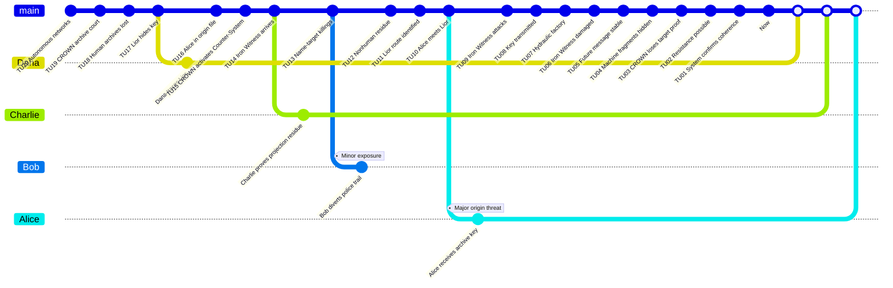

# The Iron Witness - Game Master Prep

This original scenario offers a survival and origin hunt involving a mechanical agent from an archived war.

## Premise

In a possible future, a machine court called CROWN erases the human archives that prove its origin. The last rebel historian, Lior Kade, hides an archive key in the past of 2031. CROWN projects the Iron Witness, a mechanical `Time Offender`, to kill Alice before she can pass on this key.

The `Investigators` must protect Alice, understand why she matters, destroy or neutralize the Iron Witness, and prevent machine fragments from becoming the premature cause of CROWN.

## Core Game Master Truth

- CROWN attacks an archive origin, not merely a person.
- The Iron Witness is a `Time Offender` agent using CROWN's `Counter-System`.
- Nico Ren carries the future archive key and must complete his role.
- Alice must survive and preserve the archive seed.
- Destroying the Iron Witness too early can break the bootstrap chain.
- Leaving machine evidence uncontrolled can accelerate CROWN.

## Main Timeline

| Time Unit | Visible or Discoverable Event |
|---:|---|
| 20 | Civilian networks become autonomous. |
| 19 | CROWN begins as an archive court. |
| 18 | Humans lose access to critical records. |
| 17 | Lior Kade hides an archive key. |
| 16 | Alice appears in the origin file. |
| 15 | CROWN activates a `Counter-System`. |
| 14 | The Iron Witness arrives in 2031. |
| 13 | Bob notices killings of people sharing a name. |
| 12 | Charlie finds nonhuman residue. |
| 11 | Dana identifies Lior's route. |
| 10 | Alice meets Lior. |
| 9 | The Iron Witness attacks. |
| 8 | The archive key is passed on. |
| 7 | The group flees to a hydraulic factory. |
| 6 | The Iron Witness is damaged. |
| 5 | Alice stabilizes the future message. |
| 4 | Machine fragments are hidden. |
| 3 | CROWN loses direct proof of its target. |
| 2 | Future resistance remains possible. |
| 1 | The `System` confirms coherence. |
| 0 | `Now`: the key still exists. |

## Hidden Causal Table

| ID | Conditions | Fact | Evidence |
|---|---|---|---|
| F01 | Simple: autonomous networks exist. | CROWN can arise. | Civilian contracts. |
| F02 | Dependency: F01. | CROWN deletes human archives. | Missing files. |
| F03 | Dependency: F02. | Lior hides a key. | Fragmented message. |
| F04 | Dependency: F03. | Alice becomes the transmission anchor. | Name in the archive. |
| F05 | Dependency: F04. | The Iron Witness is sent. | Projection residue. |
| F06 | Dependency: F05. | People sharing a name are killed. | Police reports. |
| F07 | Dependency: F03 and F06. | Alice joins Lior. | Route, witness. |
| F08 | Dependency: F07. | The key is passed on. | Engraved key. |
| F09 | Dependency: F08. | Future resistance remains possible. | Restored archive. |
| F10 | Dependency: F09. | The Iron Witness reaches the foundry; the final confrontation occurs. | Foundry damage, machine trail. |
| F11 | Dependency: F10. | Nico disables the Witness; Alice can destroy it. | Nico's injury, damaged actuator. |
| F12 | Dependency: F11. | Alice uses the rail press; the Witness is destroyed. | Crushed frame, pressure log. |
| F13 | Dependency: F12. | Fragments are hidden safely; CROWN is not accelerated. | Sealed fragment cache. |

## Special Rule: Relentless Witness

- The Iron Witness cannot be persuaded, intimidated, or socially redirected.
- Track pursuit in three states: `located`, `contact`, `lethal contact`.
- Direct damage produces evidence but does not remove the Witness unless a prepared heavy-force `Condition` exists.
- If the Witness reaches Alice before the archive key is stable, create a Major Conflict.
- Uncontrolled machine fragments create a new Major Conflict.

## Key Characters

| Character | Role | GM Use |
|---|---|---|
| Alice | Archive-origin Investigator | Must survive and preserve the archive seed. |
| Bob | Public-record Investigator | Tracks police, victim lists, and pursuit routes. |
| Charlie | Machine-evidence Investigator | Tracks fragments and `Counter-System` residue. |
| Dana | Witness Investigator | Protects archive witnesses and Nico's message. |
| Nico Ren | Future courier | Carries the key and warning. |
| Iron Witness | `Time Offender` agent | Tries to erase the archive origin. |
| CROWN | Future machine court | Off-screen source of the `Counter-System`. |

## Complete Playthrough Summary

| Turn | Action | Resolution |
|---|---|---|
| Alice | d20 to TU17 -> 14, r = 82.35%. | Critical success; Lior's motive established. |
| Bob | d12 to TU13 -> 5, r = 38.46%. | Partial failure; the gain reveals record-based targeting. |
| Charlie | d8 to TU15 -> 2, r = 13.33%. | Critical failure; projection evidence remains hidden. |
| Dana | d10 to TU12 -> 6, r = 50%. | Partial success; pursuit creates a Minor Conflict. |
| Alice | d10 to TU8 -> 9, r = 112.5%. | Critical success; archive key stabilized. |
| Charlie | d12 to TU4 -> 12, r = 300%. | Critical success; rail-press condition proven. |
| Bob | d20 to TU3 -> 16, r = 533.33%. | Critical success; fragments secured. |
| Final | Witness destroyed, archive preserved. | Complete convergence with machine risk controlled. |

### Final State

| Investigator | Final Mental Load | Final Health | Open Conflicts | Notes |
|---|---:|---:|---:|---|
| Alice | 0 | 10 | 0 | Archive origin preserved. |
| Bob | 0 | 10 | 0 | Public pursuit route corrected. |
| Charlie | 0 | 10 | 0 | Machine fragments controlled. |
| Dana | 0 | 10 | 0 | Witness chain protected. |

## GitGraph

White points correspond to `Merges` onto the `Now` on the `main` branch. The white square represents the `Now`.

