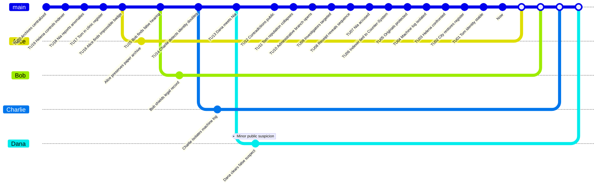

# Public Record Trap - Game Master Prep

This original scenario uses impossible administrative evidence and an attack on the `Investigators'` public identities.

## Premise

Tom Arlen discovers his name in four contradictory public documents: a clinic register, a municipal hearing, an archive badge, and an association receipt. Each document proves he was present somewhere impossible. The `Investigators` initially suspect a chain of hoaxes or Nia Rusk, a contentious archivist.

The real adversary is Helena Orvek, the Registrar. She uses a `Counter-System` embedded in a municipal indexing machine to create administrative branches that trap people's identities.

## Main Timeline

| Time Unit | Visible or Discoverable Event |
|---:|---|
| 20 | The city centralizes its public archives. |
| 19 | Helena Orvek takes control of the indexer. |
| 18 | Nia Rusk reports anomalies. |
| 17 | Tom appears in a clinic register. |
| 16 | Alice finds an impossible archive badge. |
| 15 | Bob notices a falsified hearing. |
| 14 | Charlie detects duplicate identities. |
| 13 | Dana meets Nia. |
| 12 | The contradictory documents become public. |
| 11 | Tom's reputation collapses. |
| 10 | Helena opens an administrative `Branched Timeline`. |
| 9 | The `Investigators` are added to false records. |
| 8 | An association receipt reveals the sequence. |
| 7 | Nia is accused. |
| 6 | Alice links the indexer to the `Counter-System`. |
| 5 | Bob protects the paper originals. |
| 4 | Charlie isolates the machine log. |
| 3 | Dana confronts Helena. |
| 2 | The city restores a coherent register. |
| 1 | Tom regains a stable identity. |
| 0 | `Now`: the archives no longer contradict one another. |

## Hidden Causal Table

| ID | Conditions | Fact | Evidence |
|---|---|---|---|
| F01 | Simple: the archives are centralized. | The indexer can rewrite public reputation. | Municipal contract. |
| F02 | Dependency: F01. | Helena connects a `Counter-System`. | Machine log. |
| F03 | Simple: Nia reports the anomalies. | She becomes a suspect. | Complaint letter. |
| F04 | Dependency: F02. | Tom appears in impossible places. | Contradictory registers. |
| F05 | Dependency: F04. | The `Investigators` follow the false Nia lead. | Interview, disciplinary file. |
| F06 | Dependency: F02. | Helena traps the `Investigators'` identities. | Impossible badges and receipts. |
| F07 | Dependency: F06. | Reputation conflicts increase. | Public notice. |
| F08 | Dependency: F02 and F07. | The indexer can be isolated. | Paper original, local hash. |
| F09 | Dependency: F08. | The coherent register is restored. | Corrected certificate. |

## Characters

| Character | Role | Mental Load | Health | Rewind Dice |
|---|---|---:|---:|---|
| Alice | Archive Investigator | 0 | 10 | d4, d6, d8, d10, d12, d20 |
| Bob | Legal Investigator | 0 | 10 | d4, d6, d8, d10, d12, d20 |
| Charlie | Technical Investigator | 0 | 10 | d4, d6, d8, d10, d12, d20 |
| Dana | Social Investigator | 0 | 10 | d4, d6, d8, d10, d12, d20 |
| Helena Orvek | `Time Offender` | 0 | 10 | `Counter-System` |
| Nia Rusk | False suspect | 70 | 10 | None |
| Tom Arlen | Administrative victim | 60 | 10 | None |

## GitGraph

White points correspond to `Merges` onto the `Now` on the `main` branch. The white square represents the `Now`.

