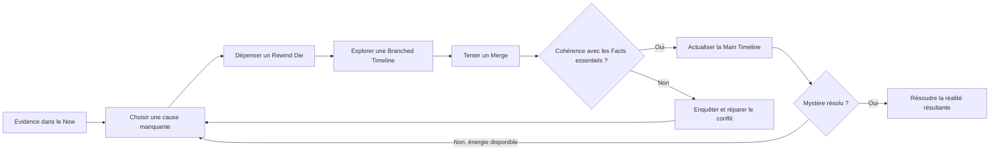

# Causality — Source de présentation pour éditeurs et investisseurs

> **Découvrez la vérité. Préservez la réalité.**
>
> Un jeu de rôle coopératif sur table où chaque réponse doit résister à ses conséquences.

## 1. Objectif et statut éditorial

Ce document rassemble la matière pour un teaser, une présentation, un dossier d'édition ou un échange avec des investisseurs autour de **Causality**. Il associe des textes réutilisables, une fiche factuelle du projet et des pistes commerciales proposées. Le mot « éditeur » désigne ici un partenaire d'édition de jeux sur table.

- **Préparation :** 27 octobre 2026, à partir de la documentation disponible dans le dépôt à cette date.
- **Langue canonique :** anglais. [Source anglaise](../../docs/presentation-source.md).
- **Documenté :** appuyé par les sources du projet citées ; cela ne constitue pas un audit indépendant.
- **Proposé :** piste de positionnement, de produit ou de présentation à discuter, sans engagement de production.
- **À compléter :** information que le créateur doit fournir avant d'utiliser l'affirmation correspondante dans une présentation externe.

Le teaser public peut s'appuyer sur les sections 2 à 7 et sur la trame de la section 13. Les sections 8 à 12 alimentent les échanges avec les partenaires. La section 14 est la liste interne des informations manquantes. Les accroches des scénarios ci-dessous ne révèlent ni les coupables ni les solutions présents dans les sources réservées au Game Master.

## 2. L'accroche

### Signature principale — proposée

**Découvrez la vérité. Préservez la réalité.**

### Autres signatures — proposées

- Chaque réponse a des conséquences.
- Vous vous souvenez d'un monde qui n'a jamais existé.
- Vingt étapes dans la causality. Une réalité à préserver.

### Pitch en une phrase

**Causality est un jeu de rôle coopératif sur table dans lequel des Investigators rejouent les causes d'un mystère, testent d'autres enchaînements d'événements et intègrent leurs découvertes à un présent cohérent avant d'épuiser leur énergie.**

### Pitch oral de trente secondes

> Et si résoudre un mystère pouvait effacer le monde qui vous a demandé de le résoudre ? Dans Causality, les Investigators utilisent un mystérieux System pour rejouer des chaînes de causes et d'effets. Chaque branche peut révéler des indices, créer des contradictions et laisser les souvenirs d'une réalité que personne d'autre ne connaît. Avec un nombre limité de dés à dépenser, le groupe doit découvrir la vérité et ramener ses découvertes dans un présent cohérent. Un projet de règles, cinq scénarios et une documentation française et anglaise existent déjà ; la prochaine étape est d'élargir les tests et de préparer une publication.

### Paragraphe de présentation

**Causality est un jeu de rôle coopératif d’enquête causale pour 2 à 5 joueurs et un maître de jeu.** Dans son univers, le temps n’existe pas : chaque événement est la conséquence des précédents, et cette chaîne cohérente peut être déroulée à l’inverse comme un écoulement réversible dans un fluide visqueux.

Le **System** est un dispositif scientifique complexe associant un ordinateur quantique aux propriétés de masse et d’énergie d’un micro-trou noir. Dans la fiction, les recherches ont unifié mécanique quantique et espace-temps en substituant à la composante temporelle le **théorème de causalité générale**. Le System en est l’application.

Il ouvre la **Causality Gate**, centrée sur la **Main Timeline**, et donne accès au **Time Flow**. Les Investigators agissent dans des **Branch**, nom court des **Branched Timelines**, puis tentent un **Merge** pour revenir dans le **Now** partagé. Les Rewind Dice représentent leurs **capsules d’énergie noire**. Modifier une cause peut effacer une preuve ou les conditions d’existence d’un enquêteur ; les Branch non intégrées alourdissent sa charge cognitive, mesurée par la Charge mentale, jusqu’au risque de folie.

Référence du récit scientifique et de l’analogie avec la cellule de Couette : [Univers et System](./univers-et-system.md). Pour une présentation centrée sur Toulouse et [Protocole Fièvre de Verre](scenarios/protocole-fievre-de-verre-preparation-mj.md), utiliser la [source NotebookLM dédiée](./source-notebooklm-presentation.md).

Le présent est une preuve. Derrière lui se cache une chaîne de causes que personne ne comprend entièrement. Causality place cette chaîne au centre de la table : les joueurs suivent les indices, dépensent de précieux Rewind Dice pour ouvrir d'autres branches et testent ce qui s'est réellement passé. Une découverte rejoint la réalité commune seulement si ses conséquences peuvent être conciliées avec le présent. Les contradictions exigent de nouvelles recherches. Les réalités non Merged laissent des souvenirs. À la fin du mystère, un seul monde reste observable — mais les Investigators peuvent en garder plusieurs en mémoire.

## 3. Le projet en bref — documenté

| Élément | Information actuelle |
|---|---|
| Format | Jeu de rôle coopératif sur table avec un Game Master. |
| Groupe | 1 Game Master et 2 à 5 joueurs, selon le quickstart. |
| Expérience centrale | Enquête, raisonnement causal, récit collectif, gestion de ressources et pression psychologique. |
| Principe | Le System rejoue la causality et maintient des états possibles ; les Investigators ne voyagent pas physiquement dans le temps. |
| Structure | Exactement 20 Time Units Atomic avant le Now ; l'échelle du scénario peut couvrir des heures, des années ou des siècles. |
| Matériel | Tableau partagé ou grande feuille, cartes ou notes adhésives, et un set standard de sept dés polyédriques par Investigator. |
| Numérique | La configuration documentée fonctionne sans application. Un tableau numérique partagé constitue une alternative. |
| Développement | Projet de règles et matériel disponibles pour poursuivre les playtests ; plusieurs questions d'équilibrage restent ouvertes. |
| Scénarios disponibles | Cinq préparations de scénario pour le Game Master. |
| Test à table consigné | [Glass Fever Protocol](scenarios/protocole-fievre-de-verre-preparation-mj.md), mode starter : 2 joueurs, environ 4 heures, sans Time Offender actif. |
| Langues | Documentation canonique anglaise et documents correspondants en français. |
| Licence du dépôt | CC0 1.0 Universal, selon la licence et le guide de contribution du dépôt. |
| Préparation commerciale | Date de sortie, spécifications de production, prix, budget, équipe et résultats commerciaux à compléter. |

L'observation de quatre heures concerne uniquement ce test starter. Elle ne constitue pas une durée validée pour tous les scénarios ou toutes les tailles de groupe. La configuration de 2 à 5 joueurs est une cible de conception au-delà du test à deux joueurs consigné.

Sources : [présentation du projet](../../README.md), [quickstart](../../docs/quickstart.md), [validation du starter](../../docs/scenarios/glass-fever-protocol-gm-prep.md#table-validation), [politique linguistique](../README.md), [licence](../../LICENSE).

## 4. Ce que font les joueurs

Le Game Master prépare un réseau caché de **Facts**, de **Conditions** et d'**Evidence**. Les joueurs commencent avec un dossier incomplet et construisent une **Main Timeline** partagée à partir de découvertes confirmées.

1. **Enquêter :** examiner les indices et identifier une cause manquante.
2. **S'engager :** choisir une Time Unit antérieure et dépenser un Rewind Die.
3. **Explorer :** agir dans une **Branched Timeline** temporaire, découvrir ou modifier des Facts.
4. **Tenter un Merge :** rejouer les conséquences jusqu'au **Now**.
5. **Réparer :** résoudre les contradictions par des choix ou de nouvelles actions causales.
6. **Préserver :** maintenir une réalité cohérente en gérant l'énergie et la **Mental Load**.

Une ouverture peut aussi échouer tout en consommant son dé. Le schéma résume la boucle après une ouverture réussie, sans détailler tous les résultats possibles.

### Un moment concret à la table

La Main Timeline établit qu'un laboratoire a explosé. Un Investigator ouvre une branche, trouve un code et désamorce la bombe. Son action révèle quelque chose d'important, mais le Merge est bloqué : un Fact essentiel n'a plus de cause. Le groupe doit enquêter ou créer une chaîne causale compatible avant que la branche puisse rejoindre le présent partagé.

**La question dramatique :** que ferez-vous de la vérité si vos actions menacent la réalité que vous devez préserver ?

Exemple adapté des [exemples de règles](../../docs/game-design.md#27-short-example). Les règles permettent aussi un Now accepté cohérent ; le pitch ne doit pas laisser entendre que chaque détail secondaire est définitivement immuable.

## 5. Ce qui distingue l'expérience

Ces différences s'appuient sur la conception du jeu ; elles ne constituent pas des affirmations d'exclusivité sur le marché.

| Élément de conception | Expérience pour les joueurs | Image proposée |
|---|---|---|
| Enquête par rejeu causal | Tester une explication par l'action et observer ses conséquences. | Un indice devient une chaîne d'événements ramifiée. |
| Merges et conflits structurels | Une découverte doit rester cohérente ; une contradiction majeure exige une action supplémentaire plutôt qu'un jet chanceux. | Deux branches devant une jonction bloquée. |
| Dés comme énergie limitée du System | Chaque rewind engage une réserve visible d'occasions. | Un dé retiré d'une petite réserve. |
| Risque lié à la distance de rewind | Arbitrer entre profondeur d'enquête et ressources disponibles. | Une branche longue vers un événement ancien. |
| Mental Load des réalités non résolues | Une expérience alternative a un coût personnel même sans rejoindre la réalité commune. | Un Investigator tient des photos incompatibles. |
| Carte causale partagée | Le raisonnement du groupe devient visible et évolue pendant la partie. | Des mains relient des cartes d'Evidence. |
| Échelle variable des scénarios | La structure en vingt unités accueille différentes époques et différents mystères. | Archives familiales, dossiers de quarantaine, ordres militaires. |

Trois idées à garder dans les diapositives principales : **tester les causes, intégrer les conséquences, se souvenir de l'impossible.**

## 6. Détails de règles pour les notes de présentation — documentés

- Chaque Investigator commence avec **10 Health** et **0 Mental Load**.
- Les six Rewind Dice à usage unique représentent les **capsules d’énergie noire** : **d4, d6, d8, d10, d12 et d20**. Le d10 de pourcentage sert aux jets d’action ; les lancers d’action et de dégâts ne consomment pas de capsule.
- Tout Rewind Die disponible peut viser une distance de 1 à 20 Time Units. Le score d'ouverture est `(résultat du dé / distance de rewind) × 100` ; les résultats élevés sont meilleurs.
- Les **Minor Conflicts** utilisent un choix du joueur et un jet d'action au pourcentage affecté par la Mental Load. Les **Major Conflicts** bloquent le Merge et exigent une réparation causale.
- La Mental Load de fin de tour vaut `30 × branches non Merged + 40 × Major Conflicts non résolus + 20 × Minor Conflicts non résolus + autres pénalités actives`. À 100 ou plus, le personnage perd sa cohérence psychologique selon les règles actuelles.
- Les attaques permises par la fiction touchent automatiquement ; le jet détermine les dégâts. L'enquête est le défi central.
- Les fins possibles comprennent convergence complète, convergence incomplète, divergence psychologique et rupture causale.

La référence pour jouer reste le texte complet des règles. Les résultats de rewind, les dégâts, les pénalités finales de divergence et d'autres questions ouvertes demandent encore des tests. Sources : [game design](../../docs/game-design.md), [quickstart](../../docs/quickstart.md), [fiche Investigator](../../docs/investigator-sheet.md).

## 7. Une collection de mystères — contenu documenté, accroches proposées

| Scénario | Accroche sans révélation majeure | Axe de conception |
|---|---|---|
| **[Glass Fever Protocol](scenarios/protocole-fievre-de-verre-preparation-mj.md)** | Des villes scellées. Une maladie dévastatrice. Une histoire officielle trop parfaite. Retrouvez l'origine et préservez les preuves d'un remède sans effacer le monde qui vous a envoyés. | Enquête starter, chaînes d'Evidence, adversaire actif optionnel. |
| **[Ashfall Battalion](scenarios/bataillon-cendre-preparation-mj.md)** | Un débarquement condamné se répète. Chaque mort mémorisée apporte un indice et un coût. Trouvez la source de commandement avant la dernière tentative. | Boucles tactiques, Counter-System hostile, pression des souvenirs. |
| **[The Clockmaker's Child](scenarios/enfant-de-l-horloger-preparation-mj.md)** | Une famille se défait lorsque la rencontre qui l'a rendue possible est perturbée. Reconstruisez une origine sans détruire la cause de sa réparation. | Identité, relations et paradoxe d'origine familiale. |
| **[The Iron Witness](scenarios/temoin-de-fer-preparation-mj.md)** | Une machine poursuit la chaîne qui produira un jour un témoignage décisif. Protégez l'origine d'une archive alors que son futur vous traque. | Poursuite, survie, continuité d'archives, dépendances en boucle. |
| **[Public Record Trap](scenarios/piege-des-archives-publiques-preparation-mj.md)** | Les archives disent que vous étiez là. Les témoins confirment. Vous vous souvenez d'un autre choix. Enquêtez sur une trace administrative qui devient un ordre. | Suspense bureaucratique, identité, Evidence manipulée. |

Il s'agit de scénarios écrits, pas de cinq produits validés indépendamment. Les sources GM révèlent les solutions : [Glass Fever](../../docs/scenarios/glass-fever-protocol-gm-prep.md), [Ashfall](../../docs/scenarios/ashfall-battalion-gm-prep.md), [Clockmaker](../../docs/scenarios/clockmakers-child-gm-prep.md), [Iron Witness](../../docs/scenarios/iron-witness-gm-prep.md), [Public Record](../../docs/scenarios/public-record-trap-gm-prep.md).

## 8. Ce qui existe et ce que cela démontre

| Ressource ou élément de preuve | Affirmation étayée | Limite |
|---|---|---|
| Référence de conception | Concepts, procédures de résolution et questions ouvertes sont écrits. | Un projet de règles n'établit pas un équilibrage final. |
| Quickstart et guide GM | Le dépôt propose une préparation de première séance et une méthode de création de scénario. | Apprentissage autonome et temps de préparation à mesurer. |
| Cinq préparations de scénario | Le principe a été développé pour plusieurs types de mystère. | Exemples et déroulés écrits n'établissent pas cinq tests réels. |
| Note de validation du starter | Un test à deux joueurs est consigné comme jouable, pour environ quatre heures. | Une seule configuration ne démontre ni usage général ni demande commerciale. |
| Fiche Investigator et six abaques | Des aides existent pour suivre les ressources et les résultats. | Mise en page de publication et accessibilité à établir. |
| Documents anglais et français | Une structure bilingue existe. | Révision éditoriale et qualité de localisation à évaluer. |
| Utilitaire Python local | Un outil permet les jets et la génération de tables de référence. | La simulation ne prouve ni plaisir des joueurs ni résultats commerciaux. |
| Catalogue d'effets temporels | Des ressources supplémentaires de conception narrative existent. | Les entrées ne sont ni des modules livrés ni des adaptations autorisées d'œuvres tierces. |

Aucun chiffre de ventes, d'audience, de liste de diffusion, de précommandes, aucun prix, accord d'édition ou engagement d'investissement vérifié n'a été identifié dans la documentation examinée. N'ajouter ces éléments qu'avec une preuve et une date.

Sources : [index documentaire](../../README.md#documentation), [guide GM](../../docs/game-master-guide.md), [abaques](../../docs/abacus/README.md), [utilitaire de dés](../../scripts/simulate_dice_rolls.py), [catalogue d'effets](../../docs/temporal-effect-ideas.md).

## 9. Public et positionnement — hypothèses à valider

**Public principal envisagé :** groupes de jeu de rôle appréciant les mystères coopératifs, les indices visibles, la fiction spéculative et les conséquences qu'ils peuvent analyser ensemble.

**Public secondaire envisagé :** Game Masters recherchant des enquêtes causales structurées, et joueurs attirés par la tension psychologique, les réalités alternatives et les souvenirs incompatibles avec le monde.

**Proposition de valeur :** transformer un « et si ? » en enquête jouable, avec une carte causale commune, des tentatives limitées et des conséquences qui reviennent à la table.

**Questions d'adoption :** un nouveau GM peut-il arbitrer un Merge de manière cohérente ? Les joueurs comprennent-ils la différence entre rejeu causal et voyage temporel physique ? Plusieurs branches peuvent-elles être gérées sans suivi excessif ni attente ? Quels temps de préparation et de séance sont acceptables ?

La conception cite **Continuum: Roleplaying in the Yet** comme inspiration pour ses conséquences temporelles rigoureuses. Présenter cette influence comme une inspiration ; le dépôt n'établit ni affiliation ni soutien officiel. Une comparaison actuelle des offres, une estimation du marché et une étude de disposition à payer restent à compléter. Aucun chiffre de marché n'est supposé ici.

## 10. Proposition pour les éditeurs — proposée

### Proposition éditoriale

Développer Causality en jeu d'enquête clairement enseigné, porté par un starter fort et une explication visuelle des branches et des Merges. Les règles, aides de jeu, documents bilingues et cinq projets de scénario constituent une première base de manuscrit.

### Formats possibles

| Format | Contenu possible | Travail avant engagement |
|---|---|---|
| PDF starter | Quickstart révisé, [Glass Fever](scenarios/protocole-fievre-de-verre-preparation-mj.md) starter, fiche Investigator, modèle de timeline et cartes de référence. | Tests d'apprentissage, consolidation des règles, révision, mise en page et brief artistique. |
| Livre ou PDF de base | Règles, guide GM, exemples détaillés, sélection de scénarios et aides. | Périmètre et pagination, tests élargis, révision du manuscrit et spécifications de production. |
| Recueil de scénarios | Enquêtes autonomes révisées, cartes et documents à distribuer. | Tests de chaque scénario, normes de préparation et cohérence éditoriale et visuelle. |
| Kit physique optionnel | Support de timeline, cartes d'Evidence, marqueurs de conflit et références imprimées. | Prototype, tests d'usage, devis fournisseurs et plan de livraison. |

Ces formats servent à cadrer un échange d'édition ; ce ne sont pas des sorties annoncées. Des aides numériques optionnelles pourront être évaluées ultérieurement ; le jeu actuel ne nécessite pas de produit logiciel.

### Demande suggérée à un éditeur

> Nous cherchons un partenaire d'édition pour évaluer Causality, affiner son apprentissage et son identité éditoriale, puis définir un plan de publication. La prochaine étape est une démonstration guidée du starter, suivie d'une revue du manuscrit et des besoins de production.

**À compléter :** parcours et contact du créateur, territoires et langues visés, format préféré, capacité de production, calendrier et conditions commerciales proposées.

## 11. Échange avec des investisseurs — proposé, dossier économique à établir

### Logique de financement

La prochaine étape consiste à déterminer si les documents existants peuvent devenir une expérience publiée reproductible, compréhensible et commercialement viable. Relier les ressources à des jalons produisant des preuves, sans supposer une audience ou un rendement.

### Sources de revenus à évaluer

- Vente d'éditions numériques ou imprimées révisées et mises en page professionnellement.
- Scénarios supplémentaires et recueils.
- Aides physiques optionnelles.
- Démonstrations ou événements animés, si le créateur dispose de la capacité et d'éléments de demande.

Aucun revenu de ces activités n'est documenté dans les sources examinées. Prix, volumes, marges, coût d'acquisition et réachat sont à compléter.

### Ressources et jalons

| Étape | Travail proposé | Éléments à présenter au partenaire |
|---|---|---|
| 1. Validation élargie | Tester plusieurs groupes, tailles de table et GMs, dont le mode avec adversaire actif. | Comptes rendus datés, durées de préparation et de séance, incompréhensions et décisions de révision. |
| 2. Prototype éditorial | Consolider les règles ; produire un starter mis en page et des aides utilisables. | Prototype, observations d'apprentissage autonome, périmètre de publication. |
| 3. Validation commerciale | Tester l'offre auprès du public visé et obtenir des devis de production. | Intérêt ou achats documentés, hypothèses de prix testées, modèle de coûts et de distribution. |
| 4. Décision de production | Fixer livrables, responsabilités, calendrier et budget. | Plan financé, critères d'acceptation clairs et accord commercial défini. |

Aucune date ni somme n'est engagée. **À compléter :** montant et devise, forme du financement, ressources existantes, budget par activité, réserve, autonomie financière, entité juridique le cas échéant et jalon financé.

### Droits et cadrage commercial

Le dépôt indique actuellement **CC0 1.0 Universal**. Ce statut documenté doit être visible dans les échanges avec éditeurs et investisseurs. Ce brief n'établit ni propriété exclusive des règles publiées, ni portefeuille de marques, ni droits d'adaptation, ni droits sur les œuvres tierces citées comme inspirations. Le périmètre et les droits d'une future édition, de son identité, des illustrations et du partenariat restent à documenter séparément.

Présenter la valeur proposée par l'exécution : qualité éditoriale, présentation, scénarios testés, distribution et développement d'une communauté. Une proposition de licence exclusive des règles n'est pas étayée par le dépôt actuel. Sources : [licence](../../LICENSE), [guide de contribution](../../CONTRIBUTING.md).

## 12. Questions probables des partenaires

| Question | Réponse actuelle / éléments à obtenir |
|---|---|
| Quel est le jeu en une phrase ? | Utiliser le pitch de la section 2 et montrer un exemple de branche et de Merge. |
| Le jeu a-t-il été joué ? | Le starter consigne un test de deux joueurs d'environ quatre heures sans Time Offender actif. Éléments plus larges à obtenir. |
| Un nouveau GM peut-il l'animer ? | Un quickstart et un guide GM existent. Résultats d'apprentissage autonome à recueillir. |
| Pourquoi l'acheter ? | La valeur proposée est une expérience d'enquête utilisable et bien présentée. Intention d'achat et sensibilité au prix non validées. |
| Que peut publier ou financer le partenaire ? | Formats et jalons aux sections 10–11 ; périmètre, droits, coûts et responsabilités à convenir. |
| Quel est le principal risque de conception ? | Suivi causal, arbitrage des Merges, Mental Load et ressources à tester plus largement. |
| Quels résultats commerciaux ? | Aucun résultat commercial vérifié identifié dans les sources examinées. |
| Qui réalisera le projet ? | Biographie, contributeurs nommés, rôles et disponibilités à compléter. |

## 13. Brief de production de la présentation et du teaser — proposé

### Trame de dix diapositives

Une idée principale par diapositive. Garder les formules dans les notes. Les diapositives 1 à 6 constituent le teaser du concept ; les diapositives 7 à 10 ouvrent la discussion avec le partenaire.

| Diapositive | Titre / texte suggéré | Visuel et note de présentation |
|---|---|---|
| 1 | **CAUSALITY — Découvrez la vérité. Préservez la réalité.** | Une Main Timeline se ramifie ; toutes les branches tendent vers le Now. |
| 2 | **Et si votre réponse effaçait le monde qui a posé la question ?** | Un événement confirmé et un indice contradictoire. Exposer l'enjeu avant le vocabulaire. |
| 3 | **Enquêter. Ouvrir une branche. Tenter le Merge.** | Trois images : Evidence, action alternative, retour des conséquences au présent. |
| 4 | **Chaque rewind dépense une chance. Chaque réalité non résolue laisse un souvenir.** | Réserve de dés et carte de conflits. Expliquer énergie et Mental Load. |
| 5 | **Un système. Cinq mystères.** | Cinq cartes de scénarios utilisant les accroches de la section 7. |
| 6 | **Une enquête à raisonner ensemble.** | Vraie table ou maquette de concept explicitement identifiée, avec indices et branches. |
| 7 | **Une base documentée à tester plus largement.** | Projet de règles, quickstart, guide GM et documents bilingues ; préciser la portée exacte du test starter. |
| 8 | **Une opportunité d'édition à construire.** | Éditeurs : starter, jeu de base, scénarios. Investisseurs : offre et validation proposées, sans prévisions inventées. |
| 9 | **Prochain jalon : un starter utilisable de manière autonome.** | Tester, affiner, réviser, prototyper. Ajouter budget et dates une fois fournis. |
| 10 | **Ouvrez le dossier avec nous.** | Éditeurs : démonstration et revue du manuscrit. Investisseurs : échange sur jalons et budget. Ajouter les coordonnées confirmées. |

### Script de teaser d'environ soixante secondes

| Temps | Voix off | Direction visuelle |
|---|---|---|
| 0–8 secondes | « Le présent est une preuve. Mais les preuves se contredisent. » | Un dossier s'ouvre. Deux documents ne concordent pas. |
| 8–18 secondes | « Dans Causality, votre groupe enquête sur les causes d'un mystère. Le System ouvre une branche. Vous testez ce qui aurait pu se passer. » | Un dé est posé, une branche ouverte, un indice relié. |
| 18–30 secondes | « Chaque découverte a des conséquences. Ramenez-la dans le présent : une contradiction peut bloquer le Merge. » | Une branche rejoint la Main Timeline ; un marqueur de conflit apparaît. |
| 30–42 secondes | « Vos chances sont limitées. Et les réalités laissées derrière vous restent dans votre mémoire. » | Un dé quitte la réserve ; des photos incompatibles se superposent. |
| 42–52 secondes | « Des villes scellées à une famille au bord de l'effacement, suivez la chaîne. Retrouvez la cause manquante. » | Aperçus des scénarios puis carte causale. |
| 52–60 secondes | « Causality. Découvrez la vérité. Préservez la réalité. » | Titre, signature, « En développement » et contact ou lien de démo confirmé. |

Lire à voix haute et ajuster au montage ; les plages horaires constituent un guide d'édition.

### Identité visuelle et ton

- **Ambiance :** suspense d'enquête, cohérence fragile, conséquences humaines et découverte collective.
- **Motif :** cartes d'Evidence et lignes ramifiées convergeant vers un seul Now.
- **Palette possible :** anthracite, blanc de document chaud, branches cyan et conflits ambre. Associer formes et libellés aux couleurs.
- **Typographie :** titres lisibles, texte sobre, étiquettes claires sur les cartes et documents.
- **Images :** personnes enquêtant à une table, documents, indices fragmentés, concepts du System et des anneaux, atmosphères des scénarios.
- **Exactitude :** montrer un rejeu causal plutôt qu'une machine de voyage temporel physique. Identifier les maquettes et composants proposés. Utiliser des créations originales ou des ressources aux autorisations documentées ; les inspirations tierces ne sont pas des ressources visuelles disponibles.

### Consigne pour un graphiste ou un outil de présentation

> Créer une présentation attractive de dix diapositives pour Causality, jeu de rôle coopératif sur table, destinée à un teaser et à des partenaires. Commencer par « Découvrez la vérité. Préservez la réalité. » Expliquer l'expérience avec un seul exemple reliant Evidence, branche et Merge. Mettre en avant les Rewind Dice limités, les contradictions et les souvenirs des réalités non Merged. Utiliser les cinq accroches de scénarios sans révélation majeure. Présenter les ressources documentées et les limites exactes du playtest starter. Adapter les dernières diapositives à un éditeur ou à un investisseur à partir des propositions du document. Distinguer faits documentés, projets proposés et informations manquantes. Conserver les termes de jeu centraux en anglais. N'inventer ni audience, ni avis, ni références d'équipe, ni chiffres financiers, ni exclusivité, ni date de sortie, ni images de produit fini. Terminer par l'étape suivante adaptée au partenaire et des coordonnées confirmées.

## 14. Informations du créateur à compléter avant utilisation externe

| Champ | Valeur |
|---|---|
| Créateur / responsable et crédit public souhaité | **À compléter** |
| Biographie courte et expérience pertinente | **À compléter** |
| Équipe nommée, rôles, disponibilités et crédits des contributeurs | **À compléter** |
| Email et lien de projet / démo validé | **À compléter** |
| Public prioritaire : éditeur, investisseur ou versions séparées | **À compléter** |
| Partenariat recherché et demande concrète | **À compléter** |
| Périmètre du premier produit, format, langues et territoires | **À compléter** |
| Calendrier de publication visé et responsables | **À compléter** |
| Montant, devise, forme du financement et usage par jalon | **À compléter** |
| Ressources ou financements existants | **À compléter** |
| Devis, prix, distribution et modèle économique | **À compléter** |
| Autres dates de tests, configurations, résultats et citations autorisées | **À compléter** |
| Audience et ventes documentées, avec source et date | **À compléter** |
| Droits et crédits des identités, illustrations et contenus d'édition proposés | **À compléter** |

Conserver ce tableau dans la source de travail. Compléter les champs pertinents pour le public choisi avant de diffuser la présentation produite ; retirer des diapositives publiques les affirmations encore non résolues.

## 15. Sources et maintenance

| Référence | Utilisation |
|---|---|
| [README du projet](../../README.md) | Identité, principe, statut et inventaire documentaire. |
| [Game design](../../docs/game-design.md) | Vocabulaire, règles, exemples, fins, inspiration et questions ouvertes. |
| [Quickstart](../../docs/quickstart.md) | Nombre de joueurs, matériel, installation et première séance. |
| [Guide GM](../../docs/game-master-guide.md) | Structure cachée, préparation, adversaires et Merges. |
| [Fiche Investigator](../../docs/investigator-sheet.md) | Ressources, Mental Load et suivi des branches. |
| [Abaques Rewind Dice](../../docs/abacus/README.md) | Aides existantes par dé. |
| [Glass Fever Protocol](../../docs/scenarios/glass-fever-protocol-gm-prep.md) | Starter, validation à table consignée et mode avancé. |
| [Ashfall Battalion](../../docs/scenarios/ashfall-battalion-gm-prep.md) | Scénario de boucle tactique. |
| [The Clockmaker's Child](../../docs/scenarios/clockmakers-child-gm-prep.md) | Scénario d'origine familiale. |
| [The Iron Witness](../../docs/scenarios/iron-witness-gm-prep.md) | Scénario de survie et d'origine d'archives. |
| [Public Record Trap](../../docs/scenarios/public-record-trap-gm-prep.md) | Scénario d'identité bureaucratique. |
| [Catalogue d'effets](../../docs/temporal-effect-ideas.md) | Ressource supplémentaire de conception narrative. |
| [Utilitaire de dés](../../scripts/simulate_dice_rolls.py) | Outil local de développement et de tables de référence. |
| [Politique linguistique](../README.md) | Structure documentaire anglais/français. |
| [Guide de contribution](../../CONTRIBUTING.md) et [LICENSE](../../LICENSE) | Licence documentée et contexte des contributions. |

Mettre à jour cette source quand les règles, les preuves, le périmètre ou les décisions commerciales évoluent. Synchroniser avec la source anglaise. Associer une source et une date aux nouvelles affirmations factuelles ; garder la mention « proposé » tant qu'un plan n'est pas convenu.
